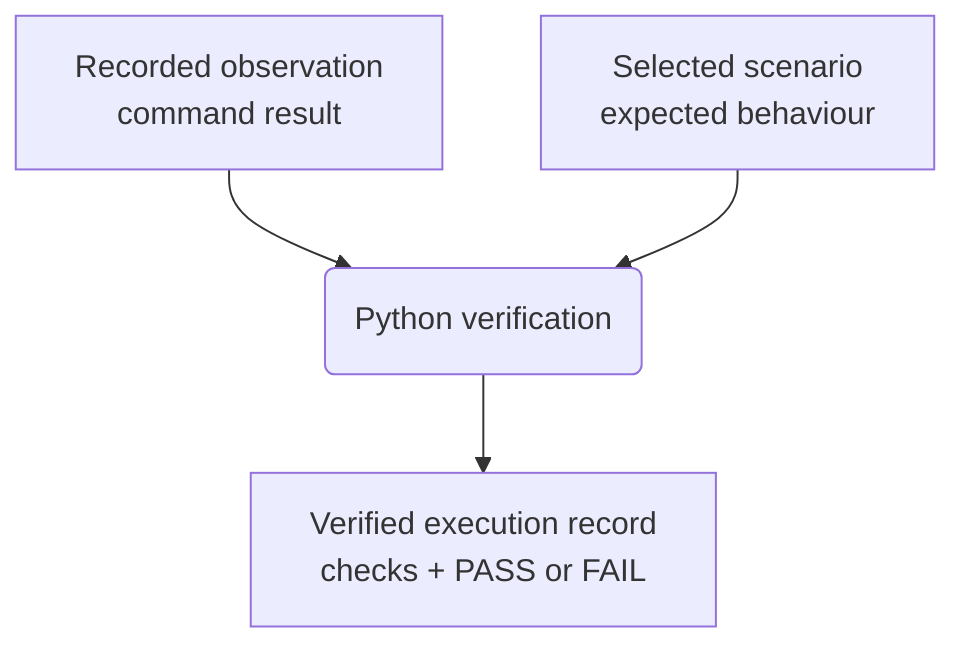

# OrbiRig

OrbiRig is a non-operational Python verification harness for simplified spacecraft mode changes. It checks recorded command results against explicitly selected expectations. Observations and check results can be exported as versioned JSON evidence.

For example, a command may request a change from `NOMINAL` (normal operation) to `SAFE` (a protective mode). OrbiRig checks the mode before and after the command, its acknowledgement (whether it was accepted or rejected), and telemetry (the reported mode). These modes form a simplified model; the harness does not control a real spacecraft.

Use the [web interface](https://orbirig-evidence-inspector.onrender.com/), command-line tool or Python API. The Python core works independently of the web application.

## Quick start

### Try it in the browser

1. Open the [web interface](https://orbirig-evidence-inspector.onrender.com/) and choose **Verify observation**.
2. Choose **Load example**, then **Verify observation**.
3. Inspect the expected and observed values. The default example records an accepted change from `NOMINAL` to `SAFE` and produces `PASS`.

To explore saved records, choose **Inspect evidence**, select an evidence type, load its example and choose **Inspect evidence**. These browser actions check recorded data; they do not execute commands.


See the [web-interface guide](docs/web-interface.md) to run it locally or use the HTTP endpoints.

### Verify a file from the command line

Install [Git](https://git-scm.com/downloads), [uv](https://docs.astral.sh/uv/getting-started/installation/) and Python 3.12–3.15, or let uv download a supported interpreter. From a terminal:

```bash
git clone https://github.com/NikolayAir/OrbiRig.git
cd OrbiRig
uv sync --locked
uv run --no-sync orbirig verify-observation docs/examples/nominal-to-safe.json \
  --scenario nominal_to_safe_mode \
  --execution-id example-001 \
  --executed-at 2026-10-21T10:00:00Z
```

The command prints a verified execution record as JSON with four passing checks and `"outcome": "PASS"`. It exits with code `0`.

See the [CLI guide](docs/cli.md) for a failing example, saving output and exit codes, or the [Python guide](docs/python.md) to execute a repeatable reference example and check sequences.

## How verification works

Choose a **scenario** to state the expected behaviour before verification. OrbiRig never infers it from the recorded result.



Each check, called an **invariant**, compares an expected value with an observed value. Verification outcomes and input errors have different meanings:

| Status | Meaning |
| --- | --- |
| `PASS` | Every check meets its expectation. A rejected command can pass when rejection is expected. |
| `FAIL` | The observation is valid input, but at least one check does not meet its expectation. |
| Input error | The data cannot be verified. Examples include invalid JSON or a command that does not match the selected scenario. No verification result is produced. |

For an ordered sequence of records, OrbiRig also checks **continuity**: the mode after one command must match the mode before the next. Records stay in the supplied order.

Loading saved verified evidence recomputes the checks and rejects results that disagree with them. A consistent `FAIL` record remains valid evidence.

The included `ReferenceSpacecraft` is a simplified substitute for a spacecraft, used to produce repeatable test observations. Separate verification rules decide whether those observations meet expectations. See [verification concepts](docs/verification.md) for the three supported scenarios and how collection, verification and saved evidence fit together.

## Documentation

| I want to… | Guide |
| --- | --- |
| Understand the scenarios, results and sequence checks | [Verification concepts](docs/verification.md) |
| Verify a saved observation in a terminal | [Command-line use](docs/cli.md) |
| Use the Python API or collect from a separate program | [Python workflows](docs/python.md) |
| Use or run the browser interface and HTTP endpoints | [Web interface](docs/web-interface.md) |
| Check JSON formats, execution IDs and timestamps | [Evidence format reference](docs/evidence-formats.md) |
| Set up development and run tests | [Contributing and development](CONTRIBUTING.md) |

## Scope

The Python API can collect one command result per invocation of a separate target program. Remote target execution over HTTP, built-in evidence storage, replay and report generation are not implemented. The project does not claim operational suitability or compliance with a space-industry standard.

## Releases and support

See [GitHub Releases](https://github.com/NikolayAir/OrbiRig/releases) for versioned release notes. Documentation on `main` describes current development; use the documentation at a release tag for that version.

For questions and reproducible bugs, use [GitHub Issues](https://github.com/NikolayAir/OrbiRig/issues). Report suspected vulnerabilities privately as described in [SECURITY.md](SECURITY.md).

## Licence

OrbiRig is available under the [MIT License](LICENSE).
