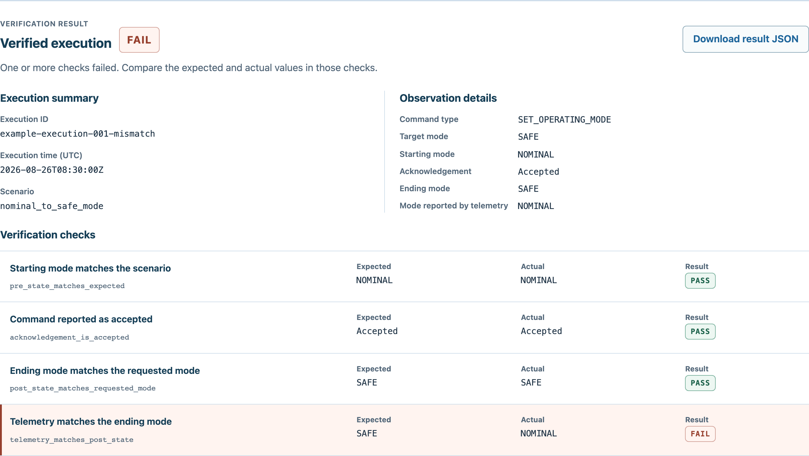
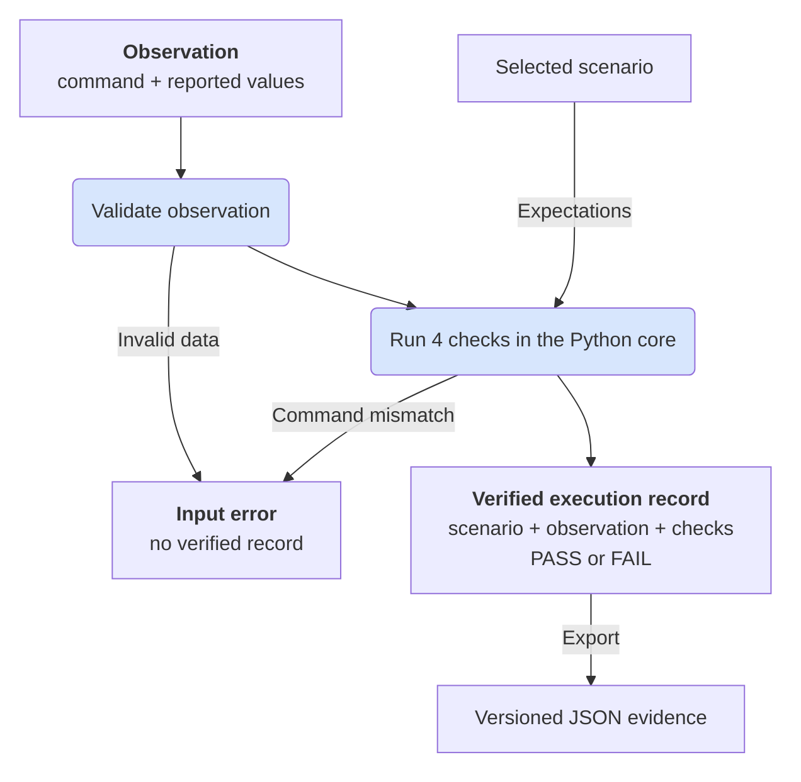

# OrbiRig

OrbiRig is a tool for checking recorded command results against expected behaviour. You choose a **scenario** that defines what you expect and provide an **observation** containing the command and what the program reported. OrbiRig shows the expected and actual values for each check, so you can see why the result is `PASS` or `FAIL`.

The three supported scenarios use a simplified, non-operational spacecraft model. It has two operating modes, `NOMINAL` for normal operation and `SAFE` for a protective mode. OrbiRig checks the mode before and after the command, the acknowledgement (whether the command was accepted or rejected), and **telemetry**, a separate report of the operating mode.

**Evidence** is a JSON document (structured text) that stores an observation, a verified record or a sequence of verified records. A verified record keeps the observation, chosen scenario and check results together, so you can review the same evidence later.

## What you can do with OrbiRig

| Interface | Tasks |
| --- | --- |
| [Browser](https://orbirig-evidence-inspector.onrender.com/) | Verify an observation or inspect saved observations, verified executions and sequences. |
| [Command line](docs/cli.md) | Verify an observation file and save the result as JSON. |
| [Python API](docs/python.md) | Verify observations and sequences, run reference commands and collect observations from separate programs. |

## Quick start

### Try it in the browser

The hosted interface runs on Render's free plan. After 15 minutes of inactivity, the service spins down, so the next visit may take about a minute to load.

1. Open the [OrbiRig web interface](https://orbirig-evidence-inspector.onrender.com/) and select the **Verify observation** workflow.
2. Choose **Load example** to fill in the inputs, then choose **Verify observation** to run the checks. The default example records an accepted change from `NOMINAL` to `SAFE` and gives `PASS`.
3. Choose **Load failing example**, then **Verify observation**. The result is `FAIL` because telemetry reports `NOMINAL` while the recorded ending mode is `SAFE`.

To explore saved records, switch to **Inspect evidence**, select an evidence type, choose **Load example**, then submit it with the **Inspect evidence** button.



See the [web-interface guide](docs/web-interface.md) to run it locally or use the HTTP endpoints.

### Verify a file from the command line

Install [Git](https://git-scm.com/downloads) and [uv](https://docs.astral.sh/uv/getting-started/installation/), which can use an installed Python 3.12–3.15 interpreter or download one if needed.

In a terminal, clone the repository, install OrbiRig and verify the included observation file.

```bash
git clone https://github.com/NikolayAir/OrbiRig.git
cd OrbiRig
uv sync --locked
uv run --no-sync orbirig verify-observation docs/examples/nominal-to-safe.json \
  --scenario nominal_to_safe_mode \
  --execution-id example-001 \
  --executed-at 2026-10-21T10:00:00Z
```

The command prints a verified execution record as JSON with 4 passing checks and `"outcome": "PASS"`. It exits with code `0`.

The [CLI guide](docs/cli.md) explains how to save a record, check a telemetry mismatch and read exit codes. The [Python guide](docs/python.md) covers running commands and checking sequences.

## How verification works

The browser, command line and Python API use the same verification rules. The Python core validates the input before it runs the four checks.



The [verification flow](docs/architecture.md#verification-flow) follows the data from collection and validation through to a result and explains which errors stop the process.

Each verification check (called an **invariant** in the API) keeps the expected value, actual value and whether they match.

| Check | What it establishes |
| --- | --- |
| Pre-state | The starting mode matches the selected scenario. |
| Acknowledgement | The reported acceptance or rejection matches the scenario. |
| Post-state | The ending mode matches the requested mode for a transition or the recorded starting mode for an expected rejection. |
| Telemetry | The separately reported mode matches the recorded ending mode. |

Enter an execution ID (a label for the command run) and its time in UTC. The verified record keeps these details with the observation, scenario, four checks and outcome.

| Status | Meaning |
| --- | --- |
| `PASS` | Every check meets its expectation. A rejected command can pass when rejection is expected. |
| `FAIL` | At least one check did not meet its expectation. |
| Input error | OrbiRig cannot check the input and returns an error without a verification result. Examples include invalid JSON and a command that does not match the scenario. |
| Collection error | OrbiRig could not get a usable observation from a separate program and has no verification result. |

You can check records together or reopen saved evidence.

- **Check a sequence.** The Python API checks **continuity** across two or more records in the order you provide. The recorded ending mode of each command must match the recorded starting mode of the next. The sequence passes when all records and all continuity checks pass.
- **Reopen saved evidence.** OrbiRig recalculates saved checks and outcomes from the stored inputs and rejects results that disagree. A correctly recorded `FAIL` can be valid evidence.

The checks establish whether the recorded data meets the selected rules. Confirming that a command actually ran or identifying who provided the data requires [independent information about its source](docs/evidence-formats.md#what-validation-establishes).

### Collect observations from a program

The Python API can use `ReferenceSpacecraft`, a test double that produces repeatable observations, or start a separate program (a subprocess) and collect its response. The selected scenario defines the rules for both cases, independently of the program that ran the command.

The [Python stateful target](docs/stateful-target.md) and optional [C#/.NET 10 target](docs/dotnet-stateful-target.md) store their mode in a file between runs. Use either target to check continuity, detect stale telemetry or investigate a missing response after a saved change. The C# program uses the same Python collector and verifier and requires the .NET SDK for local setup.

## Documentation

| I want to… | Guide |
| --- | --- |
| Understand the scenarios, results and sequence checks | [Verification concepts](docs/verification.md) |
| Follow the detailed verification flow and component responsibilities | [Architecture](docs/architecture.md) |
| Verify a saved observation in a terminal | [Command-line use](docs/cli.md) |
| Use the Python API or collect from a separate program | [Using the Python API](docs/python.md) |
| Check command results from a program that preserves state between runs | [Stateful test target](docs/stateful-target.md) |
| Verify an independent C#/.NET program and detect stale telemetry | [.NET stateful target](docs/dotnet-stateful-target.md) |
| Use or run the browser interface and HTTP endpoints | [Web interface](docs/web-interface.md) |
| Check JSON formats, execution IDs and timestamps | [Evidence format reference](docs/evidence-formats.md) |
| Set up development and run tests | [Contributing and development](CONTRIBUTING.md) |

## Releases and support

See [GitHub Releases](https://github.com/NikolayAir/OrbiRig/releases) for versioned release notes. Documentation on `main` describes current development; use the documentation at a release tag for that version.

For questions and reproducible bugs, use [GitHub Issues](https://github.com/NikolayAir/OrbiRig/issues). Report suspected vulnerabilities privately as described in [SECURITY.md](SECURITY.md).

## Licence

OrbiRig is available under the [MIT License](LICENSE).
