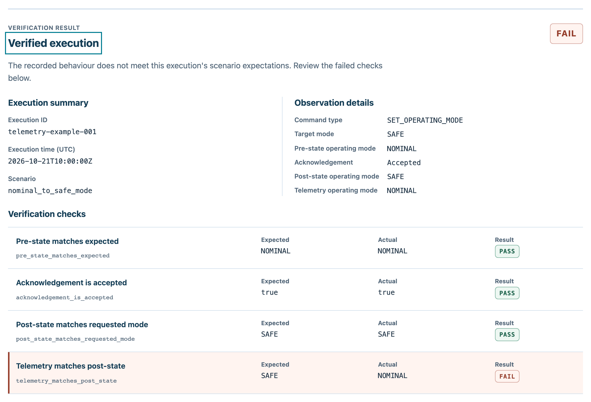
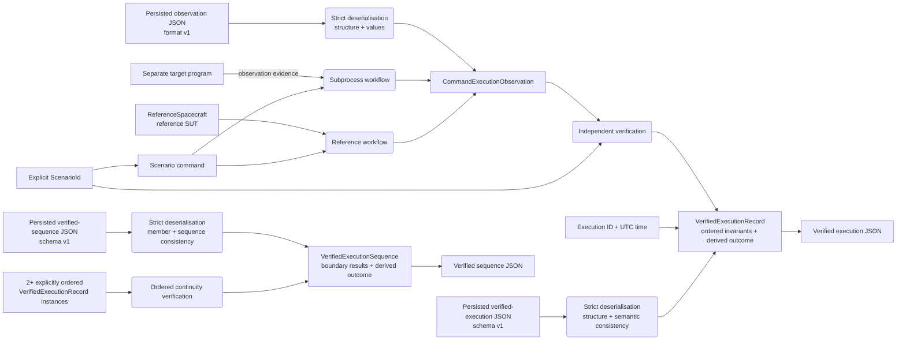

# OrbiRig

OrbiRig is a non-operational verification harness for simplified spacecraft operating-mode workflows. It verifies observed command results against explicit expected behaviour, represents observations and verification results as deterministic versioned JSON evidence, and evaluates continuity across an ordered sequence of executions.

`ReferenceSpacecraft` is a deterministic, simplified spacecraft-behaviour test double used to exercise the harness as its reference system under test (SUT). It provides repeatable behaviour for the supported scenarios, while verification remains independent of that behaviour.

**Core:** Python

**Web interface:** FastAPI · React · TypeScript · Vite · [Live](https://orbirig-evidence-inspector.onrender.com/)

**Testing and CI:** pytest · Behave · Vitest · React Testing Library · Playwright (Chromium, Firefox, WebKit) · Ruff · GitHub Actions

The web interface verifies observations against selected scenarios and provides read-only evidence inspection.



## Key capabilities

* execute three deterministic reference operating-mode scenarios and collect the command, pre-state, acknowledgement, post-state, and telemetry;
* collect observation evidence from a separate target program through a one-shot subprocess boundary;
* verify observations independently against an explicitly selected `ScenarioId`, distinguishing expected command rejection from failed verification;
* verify operating-mode continuity across execution records supplied in explicit order;
* serialise observations, verified execution records, and verified sequences to deterministic versioned JSON;
* strictly reconstruct persisted evidence and independently recompute stored verification results;
* verify a saved observation JSON file from the command line, producing canonical verified-execution evidence and distinct exit codes for PASS, FAIL and errors;
* verify submitted observation evidence and inspect all three supported evidence forms through the web interface, while evidence deserialisation and verification remain in the OrbiRig core.

## Verification flow

At a high level, OrbiRig separates observation collection, independent verification, and evidence reconstruction.



Fresh observations can come from the reference workflow or subprocess collection and capture one command execution. Persisted version `1` observation JSON reaches the same `CommandExecutionObservation` model through a separate strict deserialisation boundary. In all cases, the caller supplies the scenario expectation; it is never inferred from the observation.

## Verification boundaries

`ReferenceSpacecraft` provides deterministic reference behaviour without serving as the verification oracle. Deserialising observation evidence checks only that its structure and values are valid for the supported format; it neither selects a `ScenarioId` nor establishes verification success. The caller supplies the scenario expectation, and tests also submit intentionally inconsistent observations directly to the verifier.

Persisted derived results are treated as claims. Verified-execution deserialisation recomputes canonical invariant results and outcome; sequence deserialisation also reconstructs members canonically and recomputes continuity and the aggregate outcome in persisted order. Stored derived values must match exactly, so a canonically consistent `FAIL` record or sequence remains valid evidence.

Subprocess collection sends one compact command JSON document on stdin and requires stdout to contain exactly one valid observation-evidence document using the existing version `1` format. The collector treats launch failures, timeouts, non-zero exits, invalid UTF-8, invalid evidence, and returned-command mismatches as `ObservationCollectionError`. These failures prevent collection from producing a verified execution, so no invariant results or `VerifiedExecutionRecord` are constructed. `ExecutionOutcome.FAIL` remains reserved for successfully collected observations that violate verification expectations.

## Supported reference scenarios

| Scenario | Pre-state | Command | Expected acknowledgement | Expected post-state |
| --- | --- | --- | --- | --- |
| `NOMINAL_TO_SAFE_MODE` | `NOMINAL` | `SET_OPERATING_MODE(SAFE)` | accepted | `SAFE` |
| `NOMINAL_TO_NOMINAL_REJECTION` | `NOMINAL` | `SET_OPERATING_MODE(NOMINAL)` | rejected | `NOMINAL` |
| `SAFE_TO_NOMINAL_MODE` | `SAFE` | `SET_OPERATING_MODE(NOMINAL)` | accepted | `NOMINAL` |

For accepted transitions, verification checks the expected pre-state, accepted acknowledgement, requested post-state, and telemetry consistency with the observed post-state. For the expected rejection, a passing result requires the expected `NOMINAL` pre-state, rejected acknowledgement, state preservation, and telemetry consistency.

## Ordered execution continuity

Ordered continuity verification detects cross-execution state discontinuities that individual verified records cannot.

`verify_execution_sequence(...)` evaluates at least two explicitly ordered `VerifiedExecutionRecord` instances. For each adjacent pair, it compares the previous post-state and next pre-state operating modes and retains both execution IDs, the expected and observed modes, and the boundary result.

Supplied order is authoritative: the verifier does not sort or infer order from timestamps, execution IDs, or scenarios. A sequence passes only if all member records and continuity boundaries pass; member scenario invariants are not re-evaluated. The verifier is pure: it neither executes commands nor mutates a SUT.

## Execution evidence

OrbiRig serialises three evidence forms.

### Observation evidence

Observation evidence records the command, pre-state, acknowledgement, post-state, and telemetry from one execution. `serialize_execution_evidence(...)` writes deterministic JSON using format version `1`; `deserialize_execution_evidence(...)` strictly reconstructs a `CommandExecutionObservation` and rejects malformed JSON, duplicate object member names at any nesting level, unsupported versions, invalid shapes, missing or unexpected fields, incorrect primitive types, unknown modes, and unsupported command types.

Observation evidence contains neither `ScenarioId`, invariant results, nor a verification outcome. Successful deserialisation therefore does not mean that the observation passes verification.

### Verified execution records

`VerifiedExecutionRecord` combines an explicit execution ID, UTC execution time, selected `ScenarioId`, observation, ordered invariant results with expected and actual values, and an outcome derived from those results. The outcome is `PASS` only when all invariants pass.

Execution IDs must contain a non-whitespace character. Unicode surrogate code points (U+D800–U+DFFF) are rejected because they cannot be encoded as valid UTF-8 text. Valid Unicode characters, including emoji, are preserved exactly without replacement or normalisation. Paired surrogate escapes in JSON, such as `\ud83d\ude80`, decode to one valid Unicode character (the emoji `🚀`) and remain accepted.

This validation applies to new records and reconstruction of saved records and sequence members. Previously accepted version `1` evidence whose decoded execution IDs contain surrogate code points is now rejected; evidence structures and schema versions remain unchanged.

Timestamp text uses the same validation in saved evidence, HTTP observation verification and the CLI. The recommended form is `YYYY-MM-DDTHH:MM:SS[.fraction](Z|+00:00)`. Dates and times must be valid, hours must be `00`–`23`, and the timezone must be explicitly zero; non-zero offsets are rejected rather than converted. Fractional seconds must be exactly representable in microseconds: digits after the sixth decimal place are accepted only when they are all zero. For example, `.1234560` preserves the value `.123456`, while `.1234567` is rejected.

Previously accepted lossless forms within these limits remain supported:

- Date and time forms include compact calendar dates, ISO week dates, a single character such as a space in place of `T`, compact times, omitted minutes or seconds, and a decimal comma.
- Zero offsets may use either sign, with hours alone or with minutes and optional seconds, with or without colons. Any fractional offset digits must all be zero.
- Fractions after hours or minutes are accepted only when all their digits are zero.

Canonical output continues to use `Z` and at most six fractional digits.

Saved evidence containing precision-losing timestamps, non-zero offsets or unsupported time forms is now rejected consistently across supported Python versions. Evidence structures and schema versions are unchanged.

`serialize_verified_execution_evidence(...)` writes deterministic JSON using verified-execution schema version `1`. `deserialize_verified_execution_evidence(...)` strictly reconstructs a record by independently deriving its canonical invariant results and outcome from the persisted scenario and observation, then requiring the stored derived values to match exactly. A canonically consistent `FAIL` record remains valid evidence. Package and evidence/schema versions are independent; changing one does not imply changing the other.

### Verified execution sequences

`serialize_verified_execution_sequence_evidence(...)` writes an ordered `VerifiedExecutionSequence` using verified-execution-sequence schema version `1`. Each member is stored as complete nested verified-execution data, followed by every ordered continuity result and the aggregate outcome.

`deserialize_verified_execution_sequence_evidence(...)` strictly reconstructs each member through the verified-execution evidence semantics, then recomputes continuity in persisted order. Persisted boundaries and the aggregate outcome must exactly match the canonical sequence result. Duplicate execution IDs and equal or non-monotonic timestamps remain valid; neither determines sequence order.

## Usage

### Verify a saved observation from the command line

The Python CLI checks recorded observations against an explicitly selected scenario. It requires Python 3.12–3.15 and works without web dependencies, Node.js or a browser.

From the checkout, install the core package and its console command:

```bash
uv sync --locked
```

Run the installed command through `uv run --no-sync orbirig`. For a built wheel, install it in an activated Python environment with `python -m pip install /path/to/orbirig-<version>-py3-none-any.whl`, then invoke `orbirig` directly.

Save this UTF-8 JSON as `observation.json`:

```json
{
  "evidence_format_version": 1,
  "command": {
    "command_type": "SET_OPERATING_MODE",
    "target_mode": "SAFE"
  },
  "pre_state": {"operating_mode": "NOMINAL"},
  "acknowledgement": {"accepted": true},
  "post_state": {"operating_mode": "SAFE"},
  "telemetry": {"operating_mode": "SAFE"}
}
```

```bash
uv run --no-sync orbirig verify-observation observation.json \
  --scenario nominal_to_safe_mode \
  --execution-id test-001 \
  --executed-at 2026-10-21T10:00:00Z
```

This example exits with code `0` and writes the complete canonical verified-execution JSON to stdout, including `schema_version: 1`, the supplied execution metadata, the observation, four passing invariant results and `outcome: "PASS"`. Stderr is empty.

For a FAIL example, copy the document to `bad-telemetry.json` and change only `telemetry.operating_mode` to `"NOMINAL"`:

```bash
uv run --no-sync orbirig verify-observation bad-telemetry.json \
  --scenario nominal_to_safe_mode \
  --execution-id test-002 \
  --executed-at 2026-10-21T10:00:00Z
```

This exits with code `1` and still writes a complete, valid evidence record. Its outcome is `FAIL`; `telemetry_matches_post_state` records expected `"SAFE"`, actual `"NOMINAL"` and `passed: false`. Stderr remains empty. The output can be reconstructed with `deserialize_verified_execution_evidence(...)` or submitted to verified-execution inspection in the web interface.

`FILE`, `--scenario`, `--execution-id` and `--executed-at` are required. Scenario values are exactly `nominal_to_safe_mode`, `nominal_to_nominal_rejection` and `safe_to_nominal_mode`. An expected command rejection can produce `PASS`; the selected scenario supplies the expectations. A command incompatible with that scenario is an input error.

The execution ID must contain a non-whitespace character and must not contain surrogate code points. Its value is preserved exactly. The timestamp describes the recorded execution, not the time of verification. Use `YYYY-MM-DDTHH:MM:SS[.fraction](Z|+00:00)`; the CLI also accepts the lossless UTC forms described under [verified execution records](#verified-execution-records). Evidence uses the existing canonical UTC representation with `Z`.

| Exit code | Meaning | stdout | stderr |
| --- | --- | --- | --- |
| `0` | Completed verification PASS | Canonical verified-execution JSON | Empty |
| `1` | Completed verification FAIL | Canonical verified-execution JSON | Empty |
| `2` | Invalid arguments, metadata, evidence or scenario/command mismatch | Empty | Diagnostic |
| `3` | File I/O or output write error | Empty for read errors; may be partial for write errors | Diagnostic |
| `4` | Unexpected internal error | Empty before output starts | Diagnostic and traceback |

`orbirig --help` and `orbirig verify-observation --help` exit with code `0` and write help to stdout without reading a file. Argument names cannot be abbreviated. The command accepts one local observation-evidence v1 file; `-` has no stdin meaning. It rejects malformed JSON, duplicate object members at any depth, invalid UTF-8 and a UTF-8 BOM through the existing strict evidence boundary.

For completed verification, stdout contains only the canonical JSON bytes: UTF-8, two-space indentation and LF line endings with one final newline on every operating system. Fixed inputs, including metadata, produce identical bytes. Shell redirection can save this output; there is no CLI output-file option. Input and read errors do not produce verification evidence. The CLI does not execute spacecraft commands or collect fresh observations.

### Execute and verify a reference workflow

```python
from datetime import datetime, timezone

from orbirig.evidence import serialize_verified_execution_evidence
from orbirig.execution import execute_verified_reference_workflow
from orbirig.models import ScenarioId
from orbirig.reference_sut import ReferenceSpacecraft

record = execute_verified_reference_workflow(
    spacecraft=ReferenceSpacecraft(),
    execution_id="example-001",
    executed_at=datetime(2026, 1, 1, tzinfo=timezone.utc),
    scenario_id=ScenarioId.NOMINAL_TO_SAFE_MODE,
)

print(serialize_verified_execution_evidence(record))
```

### Verify loaded observation evidence

```python
from datetime import datetime, timezone
from pathlib import Path

from orbirig.evidence import deserialize_execution_evidence
from orbirig.execution import build_verified_execution_record
from orbirig.models import ScenarioId

observation = deserialize_execution_evidence(
    Path("observation.json").read_text(encoding="utf-8"),
)

record = build_verified_execution_record(
    execution_id="loaded-001",
    executed_at=datetime(2026, 1, 1, tzinfo=timezone.utc),
    scenario_id=ScenarioId.NOMINAL_TO_SAFE_MODE,
    observation=observation,
)
```

The explicit `ScenarioId` supplied to `build_verified_execution_record(...)` selects the expectations for the loaded observation; it is not recovered or inferred from the loaded evidence.

### Execute and verify a subprocess workflow

```python
from datetime import datetime, timezone

from orbirig.execution import execute_verified_subprocess_workflow

record = execute_verified_subprocess_workflow(
    argv=["/path/to/observation-peer"],
    timeout=5.0,
    execution_id="external-001",
    executed_at=datetime(2026, 1, 1, tzinfo=timezone.utc),
)
```

The target receives `{"command_type":"SET_OPERATING_MODE","target_mode":"SAFE"}` followed by one newline for the default scenario. It must exit successfully and write exactly one valid observation-evidence version `1` document to stdout. A successfully collected observation then follows the same canonical verification path as directly loaded or reference-workflow observations, so its result may be either `PASS` or `FAIL`.

### Verify observations and inspect evidence in the web interface

Install [uv](https://docs.astral.sh/uv/getting-started/installation/) and Node.js 22.12 or later in the 22.x series (selected by `.node-version`), then install the locked web and frontend dependencies from the repository root:

```bash
uv sync --locked --extra web
cd frontend
npm ci
cd ..
```

For local development, start FastAPI and Vite in separate terminals:

```bash
uv run --no-sync python -m uvicorn orbirig.web:app --reload
```

```bash
cd frontend
npm run dev
```

During local development, Vite proxies API requests to FastAPI. For verification, the frontend sends execution metadata, the explicitly selected `ScenarioId`, and the raw observation-evidence textarea value in a JSON request. The FastAPI backend passes that string unchanged to `deserialize_execution_evidence(...)`, then delegates verification to `build_verified_execution_record(...)`. A completed verification may return either `PASS` or `FAIL`; invalid input remains a separate error response.

The read-only evidence-inspection workflow submits its textarea value unchanged as a `text/plain; charset=utf-8` request body. The FastAPI backend decodes it and delegates directly to the corresponding strict evidence deserialiser. The browser does not parse or verify submitted evidence; strict evidence validation remains server-side in both workflows.

Observation verification and all three evidence-inspection endpoints limit the complete HTTP request body to **4 MiB (4,194,304 bytes), inclusive**. For verification, this includes the JSON wrapper and the embedded evidence string as encoded in the request; inspection counts the submitted UTF-8 bytes. The backend checks the size while reading, regardless of `Content-Length`, and stops with HTTP **413** when the limit is exceeded. Content-type checks run first and return HTTP **415** for unsupported types. This limit does not apply to the Python evidence APIs.

To serve the built interface through FastAPI, build the frontend before starting the application:

```bash
cd frontend
npm run build
cd ..
uv run --no-sync python -m uvicorn orbirig.web:app
```

The production build uses [Vite 8's default browser targets](https://vite.dev/guide/migration#default-browser-target-change): Chrome/Edge 111, Firefox 114 and Safari/iOS 16.4. These targets control generated code. Browser validation covers the Playwright builds described below.

Interactive observation verification renders execution metadata, observation details, verification checks, and the derived outcome. Observation inspection renders observation details only. Verified-execution inspection adds execution metadata, explicit `ScenarioId`, verification checks, and the derived outcome; sequence inspection adds the aggregate outcome, ordered member records, and continuity checks. Canonically consistent `FAIL` records and sequences remain valid evidence.

### Reconstruct persisted verified evidence

```python
from pathlib import Path

from orbirig.evidence import (
    deserialize_verified_execution_evidence,
    deserialize_verified_execution_sequence_evidence,
)

record = deserialize_verified_execution_evidence(
    Path("verified-execution.json").read_text(encoding="utf-8"),
)

sequence = deserialize_verified_execution_sequence_evidence(
    Path("verified-sequence.json").read_text(encoding="utf-8"),
)
```

Both readers return reconstructed models only when persisted derived values match OrbiRig's independently recomputed canonical verification semantics.

## Local setup

OrbiRig supports Python 3.12–3.15. Python 3.12 is the minimum supported version.

Python 3.15 is the default for local development, selected by `.python-version`; the minor-version form allows later 3.15 patch releases. Install [uv](https://docs.astral.sh/uv/getting-started/installation/) (CI uses version 0.13.4), then run from the repository root:

```bash
uv sync --locked --extra test --extra dev --extra web
```

uv selects or downloads the interpreter and creates `.venv`, with OrbiRig installed in editable mode. No manual environment activation is needed. The `test`, `dev` and `web` extras remain optional: use `uv sync --locked --extra web` for web development alone, or `uv sync --locked` for the Python core alone. Each sync installs exactly the selected extras and removes packages no longer needed, so rerun the full command above before running all development checks.

The committed `uv.lock` records dependency versions and distributions across Python 3.12–3.15 and supported operating systems. `--locked` rejects an out-of-date lock file instead of updating it. Commands below use `uv run --no-sync` to use the prepared environment without resolving dependencies or synchronising it again. After pulling dependency changes, repeat the appropriate `uv sync --locked` command first. See [uv's locking and syncing rules](https://docs.astral.sh/uv/concepts/projects/sync/).

For a different supported interpreter, select it explicitly for both installation and execution, for example `uv sync --locked --python 3.12 --extra test --extra dev --extra web` and `uv run --no-sync --python 3.12 python -m pytest -q`. The lock fixes resolved packages; it does not make installed binaries or behaviour identical across platforms. Python patch releases are not pinned by the lock. The existing `setuptools>=68` build requirement is unchanged; uv resolves isolated build dependencies separately from the project lock.

Dependency updates should change `pyproject.toml` and/or `uv.lock` deliberately. For a targeted update within the declared constraints, run `uv lock --upgrade-package <package>`, review the diff, then synchronise and rerun the relevant checks. Dependabot checks Python (`uv`), frontend (`npm`) and GitHub Actions dependencies monthly, with at most two open version-update PRs per ecosystem. Its security-update PR limit is separate.

The Render Blueprint continues to install `.[web]` with pip and specifies `PYTHON_VERSION=3.12.15`. It does not consume `uv.lock`, so the locked local and CI installations do not make the deployed environment fully locked. When applied to the service, the Blueprint's Python setting takes precedence over `.python-version`. See [Render's Python version rules](https://render.com/docs/python-version). A deployment migration requires a separate assessment.

## Development checks

Run the Python checks:

```bash
uv pip check --python .venv
uv run --no-sync python -m pytest -q
uv run --no-sync python -m behave
uv run --no-sync python -m ruff check .
uv run --no-sync python -m pyright
```

Pyright checks the Python package, pytest tests, Behave step definitions and distribution-check scripts in standard mode, targeting Python 3.12 to retain the minimum supported language version regardless of the development interpreter. Run it from the project's Python environment; CI provides Node.js 22 for the underlying type checker.

Check the Python distributions separately:

```bash
uv run --no-sync python scripts/verify_distributions.py
```

This builds a wheel and sdist, checks their metadata and required files, and builds another wheel from the sdist. Each wheel is installed without extras or dependencies in its own temporary environment outside the checkout. The smoke check verifies the installed version and import origins, executes a reference scenario with explicit expected results, and checks verification and evidence reconstruction for both passing and deliberately inconsistent observations. Temporary environments and distributions are removed when the check finishes.

The distribution check also validates the console entry-point metadata and invokes the real installed `orbirig` command from each wheel. Independent recorded observations check PASS and FAIL, canonical output and reconstruction, malformed input, invalid UTF-8, unsupported scenarios, file errors, help and a closed output pipe. These CLI checks run without web dependencies.

The Python distributions contain the core and the optional web adapter's Python module. The sdist also includes the distribution-check scripts used by its packaging tests. Built React assets under `src/orbirig/static` are not bundled; serving the complete interface requires the checkout-based frontend build described above. The distribution check rejects accidentally bundled assets and runs after the frontend build in CI to exercise this boundary.

The pytest configuration measures branch coverage across the complete `orbirig` package and reports missing lines and branches in the terminal. There is no required minimum coverage percentage.

Behave covers the three supported reference workflows; detailed negative cases, determinism, evidence behaviour, and deserialisation boundaries are covered in pytest.

Run the frontend checks:

```bash
cd frontend
npm ci
npm run typecheck
npm test
npm run build
```

### Browser tests

Playwright tests the web interface in Chromium, Firefox and WebKit against a
real FastAPI backend. All three engines run the same scenarios, submitting
observation, verified-execution and sequence JSON and checking the results shown
on screen. From the repository root, install the locked web dependencies and
run the tests through the same Python environment:

```bash
uv sync --locked --extra web
cd frontend
npm ci
npx playwright install chromium firefox webkit
uv run --no-sync npm run test:e2e
```

On Linux, use `npx playwright install --with-deps chromium firefox webkit` to
install the browsers' system dependencies as well. `uv run --no-sync` finds the
project from `frontend/` and puts its Python environment on `PATH`, including
for the FastAPI subprocess started by Playwright.

Run a single engine with `uv run --no-sync npm run test:e2e -- --project=firefox` (or `chromium`
or `webkit`). These projects use Playwright's browser builds and desktop device
profiles. They do not establish compatibility with installed Chrome, Edge,
Firefox or Safari applications, physical devices, touch input or iOS Safari.
The E2E suite uses Vite's development server; it does not test the deployed site.

The test runner starts its own FastAPI server at `127.0.0.1:18000` and Vite at
`127.0.0.1:15173`, waits until both answer HTTP requests and stops them after the
run, including failed runs. On macOS and Linux, the configuration routes
`SIGTERM` sent to the Playwright runner through the same teardown as `SIGINT`.
Vite's `e2e` mode routes `/api` requests to this test backend.
Both ports must be free. Before starting Playwright, `npm run test:e2e` checks
both TCP ports with a one-second deadline per port. An occupied port is reported
even when its process does not answer HTTP requests. Playwright then checks HTTP
readiness; Vite stops if its assigned port is busy. Each Playwright invocation has
a timeout of five minutes covering setup and tests. The default local invocation
runs all three engines within that budget. Ordinary development continues to use
the backend on port `8000`.

The JSON fixtures and expected results are written by hand, independently of
API responses and `ReferenceSpacecraft`. The tests check that:

- The accepted command and expected command rejection examples both produce `PASS`.
- The same rejected-command observation produces `FAIL` against an explicitly
  selected scenario that expects an accepted transition. The observation does
  not choose its own verification expectations.
- Valid observations with incorrect behaviour produce `FAIL`. Each check shows
  its expected value, actual value and its own `PASS` or `FAIL` result.
- Malformed JSON and duplicate keys inside an object produce input errors,
  without verification results.
- Observation inspection shows reported values without a verification outcome.
  Verified-execution inspection accepts a canonically consistent `FAIL`,
  including an execution ID containing non-ASCII text. Record and sequence
  inspection reject a stored outcome that contradicts the evidence.
- A sequence reports a mode mismatch and an overall `FAIL` even though every
  record passes. The ending mode of one record does not match the starting mode
  of the next. Records stay in the supplied order, which differs from both
  timestamp and execution-ID sorting.

Both verification and inspection tests check that the submitted text matches
the textarea value exactly. Inputs with duplicate keys use both LF and CRLF line
endings. In local checks with Playwright 1.64.1 on macOS, Chromium and Firefox
converted CRLF to LF after `fill()`, while WebKit retained CRLF. The tests accept
only the original text or its LF equivalent at this input boundary, then require
the request to preserve that exact textarea value. They do not parse and
re-serialise evidence or normalise the request body before comparison.

Browser tests run separately from `npm test` (Vitest); `npm run typecheck` and
`npm run build` also type-check the browser tests, startup helpers and Playwright
configuration.

Vitest checks runner shutdown on macOS and Linux using temporary Node.js servers;
these checks need no Python environment or installed browsers.

The browser tests use one worker and no automatic retries. To check repeatability
across all three engines with a timeout of 15 minutes, run:

```bash
uv run --no-sync npm run test:e2e -- --repeat-each=3 --global-timeout=900000
```

The HTML report is saved in `frontend/playwright-report/`; failed tests retain traces,
screenshots and videos in `frontend/test-results/`. From `frontend/`, open the
report with `npx playwright show-report`.

### GitHub CI

GitHub Actions runs the following checks:

| Run | Python versions and operating systems | Jobs |
| --- | --- | --- |
| Ordinary pull request | Python 3.12–3.15 on Ubuntu; Python 3.12 on macOS and Windows | 10 |
| Pull request from a `release/*` branch | Python 3.12–3.15 on Ubuntu, macOS and Windows | 16 |
| Manual run (`workflow_dispatch`) | Python 3.12–3.15 on Ubuntu, macOS and Windows | 16 |
| Push to `main` | Python 3.12–3.15 on Ubuntu | 8 |

The `Python 3.12` and compatibility jobs each have a timeout of 10 minutes.
Each browser job has a timeout of 30 minutes, and the final `CI passed` job has
a timeout of one minute. Job timeouts cover setup and checks. Browser test
invocations also use the separate Playwright timeout of five minutes.

Every Python job uses uv 0.13.4 and installs dependencies from `uv.lock` with `uv sync --locked --no-editable`, preserving non-editable package installation in CI; local development remains editable. uv receives the exact interpreter path selected by `actions/setup-python`, overriding the local `.python-version` default. Subsequent Python commands use `uv run --no-sync`, so they use that environment without resolving or synchronising dependencies again.

The `Python 3.12` job selects the `test`, `dev` and `web` extras; compatibility jobs select `test` and `web`; browser jobs select only `web`. Every Python test job checks dependency consistency with `uv pip check --python .venv` and checks package imports, then runs the complete pytest suite and all Behave scenarios.

The Ubuntu/Python 3.12 job keeps the check name `Python 3.12`. It also runs Pyright, Ruff, branch coverage, frontend type checking and tests, a production build, the isolated Python distribution check, and a check that FastAPI serves the built page and favicon. The other Python test jobs run pytest with `--no-cov` to avoid duplicate coverage reports.

The `Chromium / Ubuntu`, `Firefox / Ubuntu` and `WebKit / Ubuntu` jobs each
install Python 3.12, Node.js 22 and their selected Playwright browser with its
system dependencies, type-check the frontend and browser tests, then run the
complete E2E suite for that engine with one worker. The `npm run test:e2e` command runs
through `uv run --no-sync` so Playwright's FastAPI subprocess inherits the locked
Python environment. Chromium uses the headless
shell. The jobs run on pull requests, pushes to `main` and manual runs; a failure
in one does not cancel the others. Browser tests run on Ubuntu, independently of
the Python compatibility matrix. If a job fails, it uploads the available HTML
report, traces, screenshots and videos as `chromium-failure-diagnostics`,
`firefox-failure-diagnostics` or `webkit-failure-diagnostics`. GitHub keeps these
artefacts for seven days.

The totals include a final `CI passed` job. It waits for the Python 3.12 job,
the compatibility matrix and the browser matrix, then checks their results.
Every selected Python and browser job must succeed, including all four Ubuntu
Python versions on pushes to `main`. Failures, cancellations and skipped jobs
make `CI passed` fail.

The `main` ruleset requires both `Python 3.12` and `CI passed` before merging. Required checks are configured in GitHub; changing this workflow does not update the ruleset.

The `macos-latest` runner does not establish compatibility with older macOS versions.

## Releases

Versioned release notes are available in [GitHub Releases](https://github.com/NikolayAir/OrbiRig/releases).

## Current scope

OrbiRig intentionally focuses on deterministic verification of simplified operating-mode workflows and independently inspectable execution evidence. Its web interface verifies submitted observation evidence against an explicitly selected supported scenario and provides read-only inspection of observation, verified-execution, and verified-execution-sequence evidence. The web interface itself does not execute commands against a spacecraft or external target. Outside the web interface, external target execution is limited to one command and one observation per subprocess invocation. Remote target execution over HTTP, persistent storage, replay, and report generation remain unsupported. OrbiRig does not claim compliance with any specific space-industry standard.

## Security

Report suspected vulnerabilities privately through GitHub Private Vulnerability Reporting; see [SECURITY.md](SECURITY.md).

## License

OrbiRig is available under the [MIT License](LICENSE).
