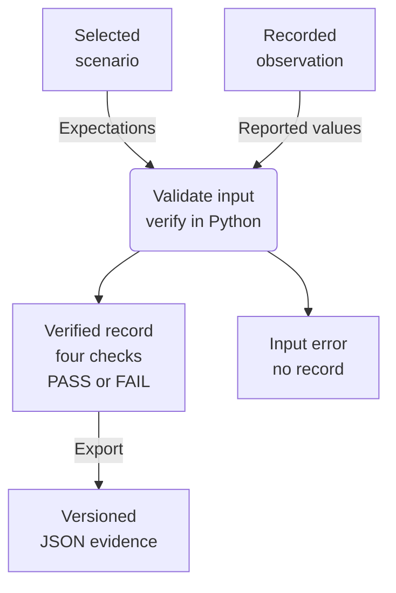

# OrbiRig

OrbiRig is a software tool for checking recorded command results against the expected behaviour of a scenario you select. Its Python core produces a `PASS` or `FAIL` record with the expected and observed values for each check, so you can see why the result passed or failed. Records can be saved and reopened as versioned JSON evidence.

The three built-in scenarios use a simplified spacecraft model. For example, a command may request a change from `NOMINAL` (normal operation) to `SAFE` (a protective mode). OrbiRig checks the mode before and after the command, its acknowledgement (whether it was accepted or rejected), and telemetry (the separately reported mode). This is a non-operational verification harness; it does not control a real spacecraft.

Use the [web interface](https://orbirig-evidence-inspector.onrender.com/), command-line tool or Python API. The Python core works independently of the web application.

## Quick start

### Try it in the browser

1. Open the [web interface](https://orbirig-evidence-inspector.onrender.com/) and choose **Verify observation**.
2. Choose **Load example**, then **Verify observation**.
3. Inspect the expected and observed values. The default example records an accepted change from `NOMINAL` to `SAFE` and produces `PASS`.

To explore saved records, choose **Inspect evidence**, select an evidence type, load its example and choose **Inspect evidence**. These browser actions check recorded data; they do not execute commands.


See the [web-interface guide](docs/web-interface.md) to run it locally or use the HTTP endpoints.

### Verify a file from the command line

Install [Git](https://git-scm.com/downloads), [uv](https://docs.astral.sh/uv/getting-started/installation/) and Python 3.12–3.15, or let uv download a supported interpreter. From a terminal:

```bash
git clone https://github.com/NikolayAir/OrbiRig.git
cd OrbiRig
uv sync --locked
uv run --no-sync orbirig verify-observation docs/examples/nominal-to-safe.json \
  --scenario nominal_to_safe_mode \
  --execution-id example-001 \
  --executed-at 2026-10-21T10:00:00Z
```

The command prints a verified execution record as JSON with four passing checks and `"outcome": "PASS"`. It exits with code `0`.

See the [CLI guide](docs/cli.md) for a failing example, saving output and exit codes, or the [Python guide](docs/python.md) to execute a repeatable reference example and check sequences.

## How verification works

Choose a **scenario** to state the expected behaviour before verification. Provide a recorded **observation**, or use the Python API to execute a command and collect one. OrbiRig never chooses the scenario from the recorded result.



Rounded boxes show actions; square-cornered boxes show data or results. Invalid input and collection errors produce no verified record. See the [architecture guide](docs/architecture.md#verification-flow) for the detailed collection, validation and error paths.

The **Python core** owns validation, scenario rules, verification and evidence formats. The React/TypeScript web interface and the CLI use the same core, so the verification rules stay consistent across interfaces. Both check recorded data without executing commands.

The Python API can collect an observation from the included `ReferenceSpacecraft` or a separate target program, invoked as a subprocess. `ReferenceSpacecraft` is a simplified, deterministic **test double** used to produce repeatable observations; separate verification rules decide whether those observations meet expectations.

Each verification check, called an **invariant**, retains the expected value, observed value and whether they match:

| Check | What it establishes |
| --- | --- |
| Pre-state | The starting mode matches the selected scenario. |
| Acknowledgement | The reported acceptance or rejection matches the scenario. |
| Post-state | The mode after the command matches the scenario's target, or the starting mode when rejection is expected. |
| Telemetry | The reported mode matches the observed post-state. |

Provide an execution ID and a UTC timestamp for the recorded execution. The verified record retains the selected scenario, observation, all four checks and overall outcome. Verification outcomes and errors have different meanings:

| Status | Meaning |
| --- | --- |
| `PASS` | Every check meets its expectation. A rejected command can pass when rejection is expected. |
| `FAIL` | The observation is valid input, but at least one check does not meet its expectation. |
| Input error | The data cannot be verified. Examples include invalid JSON or a command that does not match the selected scenario. No verification result is produced. |
| Collection error | No usable observation was collected, for example because the target subprocess timed out. No verification result is produced. |

You can also check records together or reopen saved evidence:

- **Check a sequence.** For two or more records, OrbiRig checks **continuity**: the mode after one command must match the mode before the next. The records stay in the order you provide them. The sequence passes only when every record and every continuity check passes.
- **Reopen saved evidence.** Loading verified execution or sequence JSON validates its format and recomputes the checks and outcome, including continuity for a sequence. Stored results must agree exactly; inconsistent evidence is rejected. A consistent `FAIL` remains valid evidence.

See [verification concepts](docs/verification.md) for the three supported scenarios, observation collection and sequence checks, or the [evidence format reference](docs/evidence-formats.md) for JSON fields and validation rules.

## Documentation

| I want to… | Guide |
| --- | --- |
| Understand the scenarios, results and sequence checks | [Verification concepts](docs/verification.md) |
| Follow the detailed verification flow and component responsibilities | [Architecture](docs/architecture.md) |
| Verify a saved observation in a terminal | [Command-line use](docs/cli.md) |
| Use the Python API or collect from a separate program | [Python workflows](docs/python.md) |
| Use or run the browser interface and HTTP endpoints | [Web interface](docs/web-interface.md) |
| Check JSON formats, execution IDs and timestamps | [Evidence format reference](docs/evidence-formats.md) |
| Set up development and run tests | [Contributing and development](CONTRIBUTING.md) |

## Scope

The Python API can collect one command result per invocation of a separate target program. Remote target execution over HTTP, built-in evidence storage, replay and report generation are not implemented. The project does not claim operational suitability or compliance with a space-industry standard.

## Releases and support

See [GitHub Releases](https://github.com/NikolayAir/OrbiRig/releases) for versioned release notes. Documentation on `main` describes current development; use the documentation at a release tag for that version.

For questions and reproducible bugs, use [GitHub Issues](https://github.com/NikolayAir/OrbiRig/issues). Report suspected vulnerabilities privately as described in [SECURITY.md](SECURITY.md).

## Licence

OrbiRig is available under the [MIT License](LICENSE).
