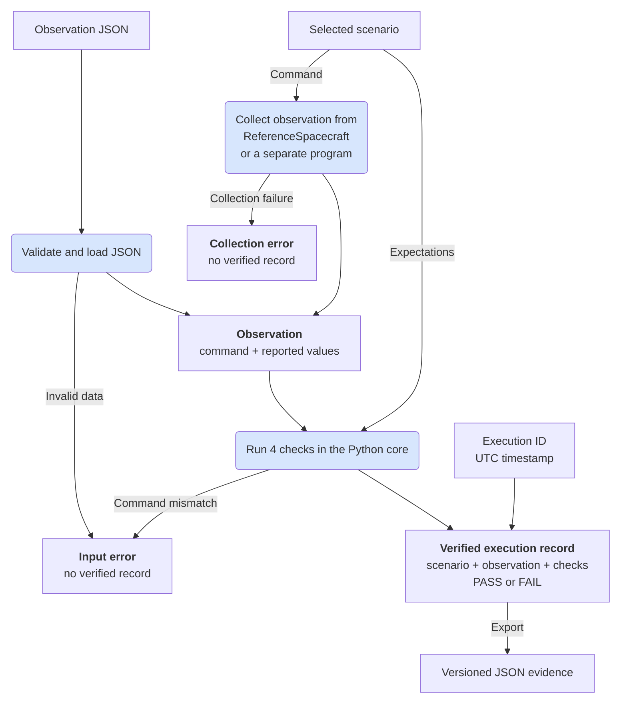

# Architecture

[README overview](../README.md#how-verification-works) · [Verification concepts](verification.md) · [Using the Python API](python.md) · [Evidence formats](evidence-formats.md)

OrbiRig separates collecting a command's reported result, checking it against explicit expectations, and displaying or exporting the checks. The Python core validates inputs, defines scenario expectations, performs verification and reads or writes evidence. The command line and HTTP API call this core, while the React/TypeScript web interface submits requests to the API and displays the results. The core works without FastAPI, React, Node.js or a browser.

## Verification flow

The [README diagram](../README.md#how-verification-works) gives a compact overview. The detailed diagram below shows how an observation is loaded from JSON or collected during command execution, then checked against a separately selected scenario. It also shows where input and collection errors prevent record creation.

Rounded boxes show actions; square-cornered boxes show data or results. The caller selects the scenario independently of the recorded values and provides the execution ID and UTC timestamp. Invalid metadata also prevents record creation.

The Python API builds reference observations directly from `ReferenceSpacecraft` state, acknowledgement and telemetry. For subprocesses, collection validates the returned JSON with the same reader used for saved observations; invalid output follows the collection-error path.

A valid observation can produce `FAIL`; an expected command rejection can produce `PASS`. Invalid input, a command incompatible with the selected scenario or a collection failure produces no verified record. A collection or verification error does not establish whether an external target changed state. See [verification concepts](verification.md) for the checks and their meaning, and the [Python collection guide](python.md#collect-from-a-separate-program) for the subprocess protocol.

## Component responsibilities

| Component | Responsibility |
| --- | --- |
| [Models](../src/orbirig/models.py) | Define the supported scenarios, commands, observations, execution metadata and result structures. |
| [Verification](../src/orbirig/verification.py) | Compare observations with explicit scenario expectations and check continuity between adjacent records without changing their order. |
| [Command execution and observation collection](../src/orbirig/execution.py) | Select the scenario's command, collect its observation from [ReferenceSpacecraft](../src/orbirig/reference_sut.py) or a [separate program](../src/orbirig/subprocess_collection.py), then request verification. |
| [Evidence JSON](../src/orbirig/evidence.py) | Validate JSON structures and values, serialise evidence and recompute the checks and outcomes when reopening saved verified records. |
| [Command line](../src/orbirig/cli.py) and [HTTP API](../src/orbirig/web.py) | Read input, call the Python core and return results or errors. These interfaces check recorded data without executing spacecraft commands. |
| [Browser interface](../frontend/src/App.tsx) | Submit observations or saved evidence to the HTTP API and display results, request errors and cancellation status. |

[`ReferenceSpacecraft`](../src/orbirig/reference_sut.py) is a simplified, deterministic test double used to produce repeatable observations. The verifier defines expectations independently of this test double.

Loading saved verified evidence recomputes its checks and outcome rather than trusting the stored results. Sequence loading also reconstructs each record and checks continuity in the saved order. The saved checks and outcome must match the recalculated results, including for `FAIL` evidence. See [loading saved evidence](verification.md#loading-saved-evidence) and the [JSON formats and validation rules](evidence-formats.md).
