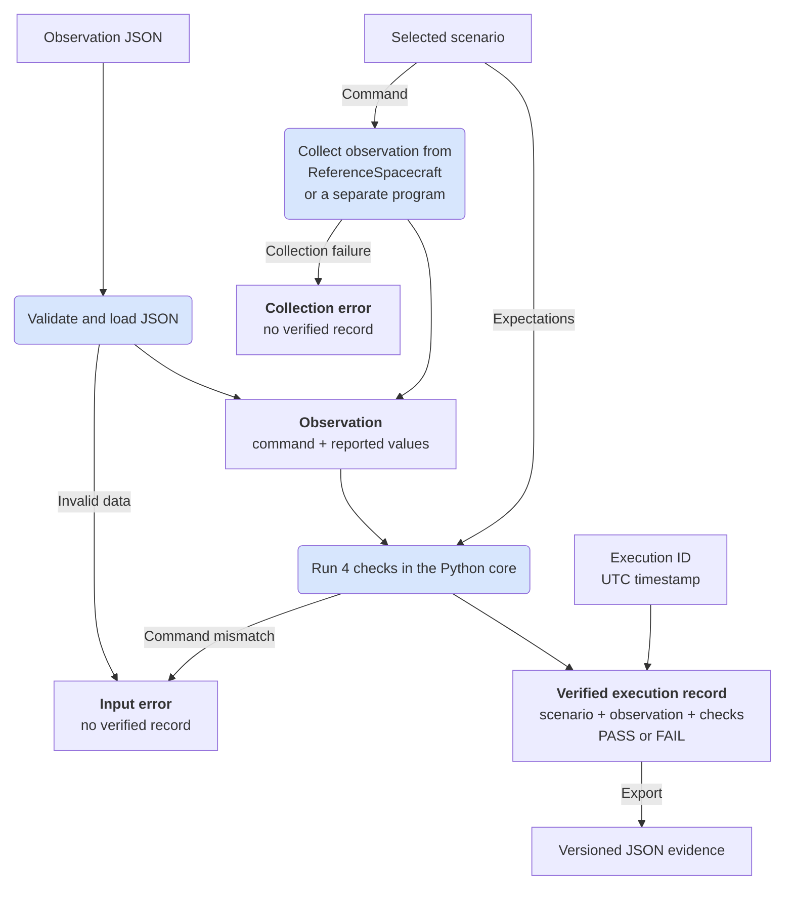

# Architecture

The Python core owns the scenario rules, JSON validation and verification results. The command line calls it directly. The React/TypeScript interface submits recorded data to the FastAPI adapter and displays its response. You can use the core on its own as a Python library.

## Verification flow

The [verification overview in the README](../README.md#how-verification-works) introduces the four checks. The detailed diagram here follows an observation from a JSON file or a command run to a verified record or an error. In both paths, the caller selects the scenario and provides the execution ID and UTC time.

An invalid execution ID or timestamp also prevents record creation. Both [Python execution helpers](python.md) validate the metadata and scenario before they handle a reference command or start a target. The [subprocess helper](python.md#collect-from-a-separate-program) also validates its timeout before launch.

The Python API builds reference observations directly from `ReferenceSpacecraft` state, acknowledgement and telemetry. For subprocesses, collection validates the returned JSON with the same reader used for saved observations; invalid output follows the collection-error path.

A [collection or verification error](verification.md#collection-and-verification) leaves the external target's state unknown. A completed verification can report `FAIL` using a valid observation.

## Follow a verification request

Start with the [NOMINAL-to-SAFE observation](examples/nominal-to-safe.json). It records an accepted change from `NOMINAL` to `SAFE`, with telemetry also reporting `SAFE`. The [example HTTP request](examples/verify-observation-request.json) pairs the same observation with an execution ID, UTC timestamp and the `nominal_to_safe_mode` scenario.

1. **Submit the form.** React mounts `App` from `main.tsx`. When you choose **Verify observation**, `verifyObservation()` in `App` checks that the required fields are filled and starts the request with the current inputs. [Browser entry point](../frontend/src/main.tsx), [App](../frontend/src/App.tsx)
2. **Send the observation as text.** `verifyObservationRequest()` puts the original text in the `observation_evidence` string of `POST /api/verify/observation`. Keeping the observation as text lets Python detect repeated JSON field names. [API client](../frontend/src/apiClient.ts)
3. **Validate the input.** `verify_observation_evidence()` reads the HTTP request, resolves the selected scenario and calls `deserialize_execution_evidence()` to read a `CommandExecutionObservation`. The handler passes the observation and execution metadata to the verifier. [HTTP adapter](../src/orbirig/web.py), [Evidence reader](../src/orbirig/evidence.py)
4. **Calculate the checks.** `build_verified_execution_record()` uses the selected scenario's expectations. The ending-mode check in this example expects `SAFE` and finds `SAFE`. All four checks pass, giving the record a `PASS` outcome. [Verification core](../src/orbirig/verification.py)
5. **Display and save the result.** The handler returns display data and the canonical record in `verified_execution_evidence`, produced by `serialize_verified_execution_evidence()`. The browser checks the response shape, displays the results and uses that string for **Download result JSON**. [HTTP adapter](../src/orbirig/web.py), [Response checks](../frontend/src/apiResponses.ts), [Verification panel](../frontend/src/VerificationPanel.tsx), [Evidence details](../frontend/src/EvidenceDetails.tsx)

To follow the file back into the browser, inspect it as **Verified execution**. In Python, `deserialize_verified_execution_evidence()` recomputes the checks and outcome, then compares them with the saved values. A consistent `FAIL` record is valid evidence. When inspecting a sequence, the reader also checks continuity in the document's original record order. [Save and reopen a result](web-interface.md#save-and-reopen-a-result), [Evidence formats](evidence-formats.md)

## Component responsibilities

| Component | Responsibility |
| --- | --- |
| [Models](../src/orbirig/models.py) | Define the supported scenarios, commands, observations, execution metadata and result structures. |
| [Verification](../src/orbirig/verification.py) | Compare observations with explicit scenario expectations and check continuity between adjacent records without changing their order. |
| [Command execution and observation collection](../src/orbirig/execution.py) | Select the scenario's command, collect its observation from [ReferenceSpacecraft](../src/orbirig/reference_sut.py) or a [separate program](../src/orbirig/subprocess_collection.py), then request verification. |
| [Evidence JSON](../src/orbirig/evidence.py) | Validate JSON structures and values, reconstruct and compare derived results before serialising verified evidence, and recompute checks and outcomes when reopening it. |
| [Strict JSON reader](../src/orbirig/_strict_json.py) | Read evidence documents and the HTTP request wrapper. Reject repeated field names, malformed JSON, excessive nesting and integers exceeding Python's configured digit limit. |
| [Command line](../src/orbirig/cli.py) and [HTTP API](../src/orbirig/web.py) | Read input, call the Python core and return results or errors. These interfaces check recorded data without executing spacecraft commands. |
| [Browser interface](../frontend/src/App.tsx) | Submit observations or saved evidence to the HTTP API and display results, request errors and cancellation status. |

[`ReferenceSpacecraft`](../src/orbirig/reference_sut.py) is a simplified, deterministic test double used to produce repeatable observations. The verifier defines expectations independently of this test double.

The [evidence format reference](evidence-formats.md) lists the stored fields, their order and the rules for comparing saved and recalculated results.

### Browser modules

[`App.tsx`](../frontend/src/App.tsx) owns navigation and form inputs. It also keeps both request hooks mounted while only the selected panel is displayed. Switching between verification and inspection therefore retains inputs, results and pending requests.

| Module | Responsibility |
| --- | --- |
| [Verification panel](../frontend/src/VerificationPanel.tsx) and [inspection panel](../frontend/src/InspectionPanel.tsx) | Render inputs, actions and feedback from the state passed by `App`. |
| [API client](../frontend/src/apiClient.ts) and [response checks](../frontend/src/apiResponses.ts) | Send the original evidence text and check HTTP responses for the fields the interface needs. A complete response has four checks per execution. A sequence has at least two records and one continuity result per adjacent pair. Incomplete responses produce a request error. Python calculates the verification results. |
| [Request tracking](../frontend/src/useCancellableRequest.ts) | Track verification and inspection separately. Abort browser requests on cancellation or when React removes the application from the page, and ignore late responses after cancellation or retry, including after JSON parsing. |
| [Completion feedback](../frontend/src/useWorkflowFeedback.ts) | Coordinate announcements, focus and scrolling, giving up automatic focus when the user moves elsewhere. |
| [Evidence details](../frontend/src/EvidenceDetails.tsx) | Display observations, verification checks and sequence records in the order returned by Python. |
| [Field help](../frontend/src/FieldHelp.tsx) and [help state](../frontend/src/useVerificationFieldHelp.ts) | Share the field-tooltip markup and manage deliberate opening, dismissal and a single pinned tooltip. |
| [Page startup](../frontend/index.html) and [appearance settings](../frontend/src/AppearanceSettings.tsx) | Apply the theme and text size before React loads, then handle changes while the page is open. |

A verification download saves the canonical JSON returned by Python. For inspection, the browser keeps the submitted text and evidence type with the successful result. The inspection download includes the whole document even when the sequence view is filtered or paginated.

## Where to make a change

| Task | Start here | Related tests |
| --- | --- | --- |
| Change scenario expectations or checks | [Models](../src/orbirig/models.py), [verification](../src/orbirig/verification.py) | [Invariant checks](../tests/test_verification.py), [verified records](../tests/test_verified_execution.py) |
| Change how saved JSON is read or written | [Evidence JSON](../src/orbirig/evidence.py), [strict JSON reader](../src/orbirig/_strict_json.py) | [Record reading](../tests/test_verified_execution_deserialisation.py), [evidence writers](../tests/test_evidence_writers.py), [sequence evidence](../tests/test_sequence_evidence.py) |
| Change HTTP validation or errors | [HTTP adapter](../src/orbirig/web.py) | [Observation verification](../tests/test_web_observation_verification.py), [evidence diagnostics](../tests/test_web_evidence_diagnostics.py) |
| Change request cancellation or state across workflows | [App](../frontend/src/App.tsx), [request tracking](../frontend/src/useCancellableRequest.ts) | [Request state](../frontend/src/App.request-state.test.tsx), [cancellation](../frontend/src/App.cancellation.test.tsx) |
| Change how the browser opens or saves a file | [File picker](../frontend/src/EvidenceFilePicker.tsx), [API client](../frontend/src/apiClient.ts), [download helper](../frontend/src/downloadEvidence.ts) | [Opening files](../frontend/src/App.open-file.test.tsx), [inspection downloads](../frontend/e2e/inspection-download.spec.ts) |
| Change result presentation or sequence paging | [Evidence details](../frontend/src/EvidenceDetails.tsx) | [Result rendering](../frontend/src/EvidenceDetails.test.tsx), [sequence paging](../frontend/e2e/sequence-pagination.spec.ts) |
| Change theme or text size | [Page startup](../frontend/index.html), [appearance settings](../frontend/src/AppearanceSettings.tsx), [styles](../frontend/src/styles.css) | [Appearance](../frontend/e2e/appearance.spec.ts), [responsive layout](../frontend/e2e/appearance-layout.spec.ts) |
| Change help instructions | [Help content](../frontend/src/WorkflowHelpContent.tsx) | [Help content and interactions](../frontend/src/App.help.test.tsx) |
| Change help tabs, focus or scrolling | [Help dialog](../frontend/src/WorkflowHelp.tsx), [scroll calculation](../frontend/src/helpSectionScroll.ts) | [Help interactions](../frontend/src/App.help.test.tsx), [browser layout and focus](../frontend/e2e/help-scaling.spec.ts) |
