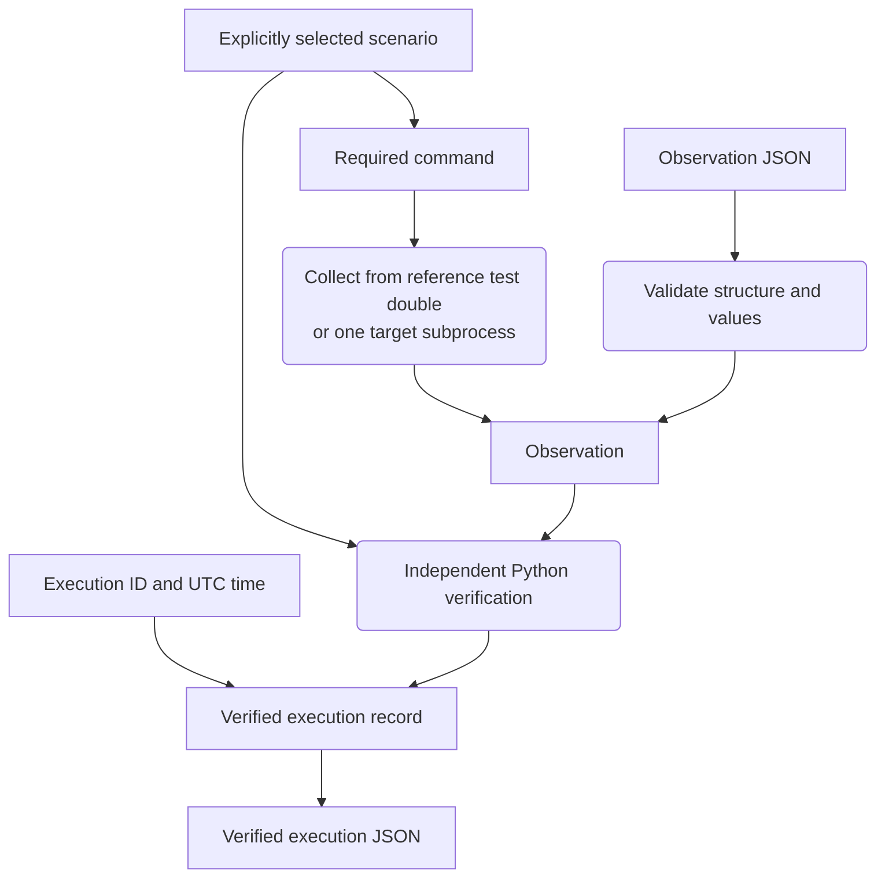

# Verification concepts

[README](../README.md) · [Python workflows](python.md) · [Evidence formats](evidence-formats.md)

OrbiRig checks whether a recorded command result meets an explicitly selected expectation. It separates collecting an observation, verifying it and loading saved evidence. This separation keeps a valid record of unexpected behaviour useful without treating an input or collection error as a verification result.

## What an observation records

An **operating mode** describes how the simplified spacecraft is operating: `NOMINAL` represents normal operation and `SAFE` represents a protective mode. The model records mode values rather than the physical behaviour of a spacecraft.

One **observation** contains:

- The **command**: a request to set the operating mode.
- The **pre-state**: the mode before command handling.
- The **acknowledgement**: whether the command was reported as accepted or rejected.
- The **post-state**: the mode after command handling.
- The **telemetry**: the separately reported operating mode.

These are reported values, not assumptions about what must have happened. The verifier compares them with the chosen scenario's rules. It does not infer the expected scenario from the command, acknowledgement, states or telemetry.

## Supported scenarios

A `ScenarioId` selects the expected behaviour. CLI arguments and JSON use these string values:

| Scenario value | Expected pre-state | Command target | Expected acknowledgement | Expected post-state |
| --- | --- | --- | --- | --- |
| `nominal_to_safe_mode` | `NOMINAL` | `SAFE` | Accepted | `SAFE` |
| `nominal_to_nominal_rejection` | `NOMINAL` | `NOMINAL` | Rejected | `NOMINAL` |
| `safe_to_nominal_mode` | `SAFE` | `NOMINAL` | Accepted | `NOMINAL` |

Python enum members use the corresponding uppercase names, for example `ScenarioId.NOMINAL_TO_SAFE_MODE`. All three scenarios use `SET_OPERATING_MODE`. A command incompatible with the selected scenario raises `ScenarioCommandMismatchError`; it does not produce `FAIL` evidence.

For an accepted transition, four **invariants** (verification checks) evaluate the expected starting mode, accepted acknowledgement, requested ending mode and whether telemetry matches the observed ending mode. For the rejection scenario, the checks require the expected `NOMINAL` starting mode, rejected acknowledgement, preservation of the observed starting mode and telemetry matching the ending mode.

Each invariant retains its identifier, expected value, actual value and whether it passed. All four must pass for the execution outcome to be `PASS`. Expected command rejection can therefore pass verification. A valid observation with incorrect behaviour produces `FAIL`.

## Collection and verification

The Python core owns expectations, verification and evidence formats. FastAPI adapts HTTP requests and responses; React displays the results. The browser and CLI verify recorded observations without executing commands.

`ReferenceSpacecraft` is a deterministic **test double**: a small substitute for a spacecraft, used to exercise the harness as its reference system under test (SUT). It starts in `NOMINAL`. Its repeatable behaviour is separate from the verification rules; it is not the source of the expected results. Tests also submit deliberately inconsistent observations directly to the verifier.

In `ReferenceSpacecraft`, command rejection and command-handling errors leave the state unchanged. This property does not establish what happened in an external target after a collection or verification error.

Subprocess collection sends one command and requires one usable observation in return. Launch failures, timeouts, non-zero exits, invalid UTF-8, invalid evidence and a returned command that differs from the submitted command raise `ObservationCollectionError`. No verified execution record or invariant results are created from these errors. A successfully collected observation can then produce either `PASS` or `FAIL`. See the [subprocess protocol](python.md#collect-from-a-separate-program).

## Continuity across executions

An execution can pass on its own yet fail to fit the executions around it. For example, one passing record ends in `SAFE`, but the next passing record starts in `NOMINAL`. The unexplained change between those records fails the continuity check.

`verify_execution_sequence(...)` takes at least two `VerifiedExecutionRecord` instances. For each adjacent pair it compares the previous post-state mode with the next pre-state mode. Each boundary result retains both execution IDs, the expected and observed modes and whether they match.

The supplied record order is authoritative. The verifier never sorts by timestamp, execution ID or scenario. Duplicate execution IDs and equal or non-monotonic timestamps are allowed. A sequence passes only when every member record and every continuity boundary passes.

Sequence verification uses the supplied member results without re-evaluating their scenario invariants. It does not execute commands or change a target's state. Loading saved sequence evidence, described below, also reconstructs each member through the canonical verifier.

## Loading saved evidence

**Deserialisation** means reading JSON back into Python models. Observation deserialisation checks the supported structure, types and values. It does not choose a scenario or decide whether the behaviour passes verification.

Saved verified results are treated as claims to check. A verified-execution reader recomputes the invariant results and outcome from the saved scenario and observation. A sequence reader also reconstructs each member, recomputes continuity in saved order and derives the overall outcome. Stored results must match those recomputed results exactly; inconsistent values are rejected rather than repaired.

These recomputed results are **canonical**: they come from the shared Python verification rules. A saved, canonically consistent `FAIL` remains valid evidence. Evidence validity and verification success answer different questions.

See the [evidence format reference](evidence-formats.md) for exact fields, versions and metadata rules, or the [Python guide](python.md#reopen-saved-verified-evidence) for loading examples.
