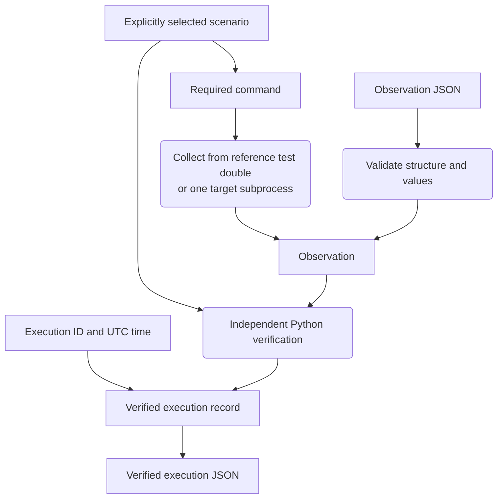

# Verification concepts

[README](../README.md) · [Python workflows](python.md) · [Evidence formats](evidence-formats.md)

Verification asks whether recorded behaviour meets a selected scenario's expectations. Collecting an observation, verifying it and loading saved evidence are separate steps.

## What an observation records

OrbiRig models two **operating modes**: `NOMINAL` for normal operation and `SAFE` for a protective mode. It records these mode values without simulating a spacecraft's physical behaviour.

One **observation** contains:

- The **command**: a request to set the operating mode.
- The **pre-state**: the mode before command handling.
- The **acknowledgement**: whether the command was reported as accepted or rejected.
- The **post-state**: the mode after command handling.
- The **telemetry**: the separately reported operating mode.

The verifier compares these reported values with the rules of a separately chosen scenario. It never infers the expected scenario from those values.

## Supported scenarios

A `ScenarioId` selects the expected behaviour. CLI arguments and JSON use these string values:

| Scenario value | Expected pre-state | Command target | Expected acknowledgement | Expected post-state |
| --- | --- | --- | --- | --- |
| `nominal_to_safe_mode` | `NOMINAL` | `SAFE` | Accepted | `SAFE` |
| `nominal_to_nominal_rejection` | `NOMINAL` | `NOMINAL` | Rejected | `NOMINAL` |
| `safe_to_nominal_mode` | `SAFE` | `NOMINAL` | Accepted | `NOMINAL` |

Python enum members use the corresponding uppercase names, for example `ScenarioId.NOMINAL_TO_SAFE_MODE`. All three scenarios use `SET_OPERATING_MODE`. A command incompatible with the selected scenario raises `ScenarioCommandMismatchError`; it does not produce `FAIL` evidence.

Each scenario evaluates four **invariants** (verification checks):

| Check | Accepted transition | Expected rejection |
| --- | --- | --- |
| Pre-state | Matches the scenario's expected starting mode | Must be `NOMINAL` |
| Acknowledgement | Accepted | Rejected |
| Post-state | Matches the commanded target mode | Matches the observed pre-state |
| Telemetry | Matches the observed post-state | Matches the observed post-state |

Each invariant retains its identifier, expected value, actual value and whether it passed. All four must pass for the execution outcome to be `PASS`. Expected command rejection can therefore pass verification. A valid observation with incorrect behaviour produces `FAIL`.

## Collection and verification

The Python core owns expectations, verification and evidence formats. FastAPI adapts HTTP requests and responses; React displays the results. The browser and CLI verify recorded observations without executing commands.

`ReferenceSpacecraft` is a deterministic **test double**, a small substitute for a spacecraft. It acts as the reference system under test (SUT) and starts in `NOMINAL`. The verifier defines expectations independently of this test double. Tests also submit deliberately inconsistent observations directly to the verifier.

In `ReferenceSpacecraft`, command rejection and command-handling errors leave the state unchanged. A collection or verification error does not tell you whether an external target changed state.

Subprocess collection requires one usable observation for the submitted command. If collection fails, it raises `ObservationCollectionError` without creating invariant results or a verified record. A successfully collected observation can then produce either `PASS` or `FAIL`. See the [subprocess protocol and collection errors](python.md#collect-from-a-separate-program).

## Continuity across executions

An execution can pass on its own yet fail to fit the executions around it. For example, one passing record ends in `SAFE`, but the next passing record starts in `NOMINAL`. The unexplained change between those records fails the continuity check.

`verify_execution_sequence(...)` takes at least two `VerifiedExecutionRecord` instances. For each adjacent pair it compares the previous post-state mode with the next pre-state mode. Each boundary result retains both execution IDs, the expected and observed modes and whether they match.

The supplied record order is authoritative. The verifier never sorts by timestamp, execution ID or scenario. Duplicate execution IDs and equal or non-monotonic timestamps are allowed. A sequence passes only when every member record and every continuity boundary passes.

The Python sequence verifier uses each member's existing invariant results. It does not re-evaluate those checks, execute commands or change a target's state. Loading saved sequence evidence also recomputes each member's checks, as described below.

## Loading saved evidence

**Deserialisation** means reading JSON back into Python models. Observation deserialisation checks the supported structure, types and values. It does not choose a scenario or decide whether the behaviour passes verification.

Saved verified results are treated as claims to check. A verified-execution reader recomputes the invariant results and outcome from the saved scenario and observation. A sequence reader also reconstructs each member, recomputes continuity in saved order and derives the overall outcome. Stored results must match the recomputed results exactly. Inconsistent values are rejected rather than repaired.

These recomputed results are **canonical**: they come from the shared Python verification rules. A saved, canonically consistent `FAIL` remains valid evidence. Evidence validity and verification success answer different questions.

See the [evidence format reference](evidence-formats.md) for exact fields, versions and metadata rules, or the [Python guide](python.md#reopen-saved-verified-evidence) for loading examples.
