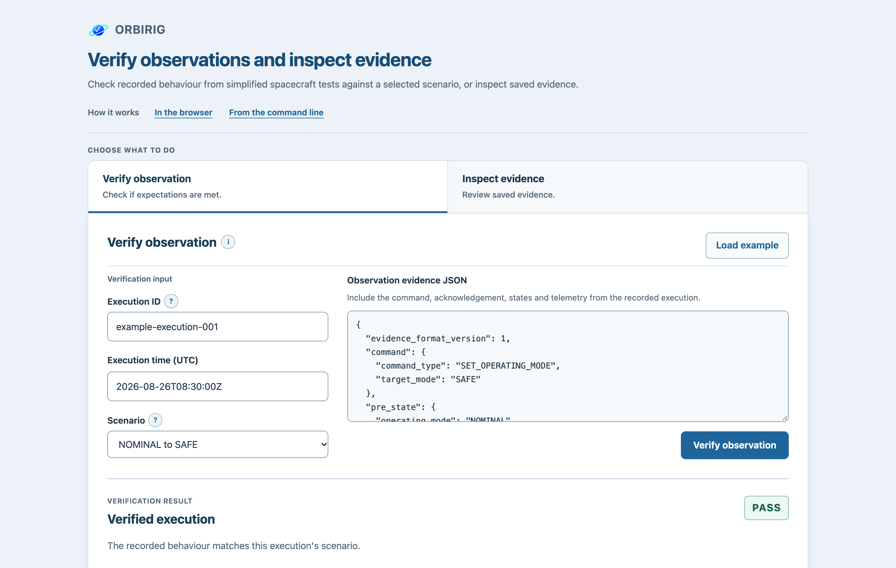

# Web interface

[README](../README.md) · [Verification concepts](verification.md) · [Development checks](../CONTRIBUTING.md)

Use the [hosted interface](https://orbirig-evidence-inspector.onrender.com/) to check a recorded command result against a scenario you select, or to reopen and inspect saved JSON evidence. The Python core performs the checks on the server; the browser displays the results and errors. These actions do not execute commands or contact an external target.

## Verify an observation

1. Choose **Verify observation** and select the scenario describing the expected behaviour.
2. Enter an execution ID, UTC execution time and observation JSON, or choose **Load example**.
3. Choose **Verify observation** to see the recorded values, each check's expected and actual values, and the overall `PASS` or `FAIL`.

**Load example** fills in a sample execution ID, UTC time and observation JSON for the selected scenario. It uses **NOMINAL to SAFE** if none is selected. Choose **Verify observation** to run the checks after loading the example.

An expected command rejection can pass. Invalid input, including a command incompatible with the selected scenario, produces an error rather than a completed `FAIL` result. See [supported scenarios](verification.md#supported-scenarios) and the rules for [execution IDs and timestamps](evidence-formats.md#execution-ids).



*OrbiRig v0.9.0 after verifying the NOMINAL-to-SAFE example.*

## Inspect evidence

Choose **Inspect evidence**, select its type and paste saved JSON or choose **Load example**. Then choose **Inspect evidence**.

| Type | What inspection shows and checks |
| --- | --- |
| Observation | Reported command, states, acknowledgement and telemetry. Loading validates the observation format; it does not produce a verification outcome. |
| Verified execution | Execution ID and time, selected scenario, observation, checks and outcome. Python recomputes the results and rejects stored mismatches. |
| Verified execution sequence | Overall outcome, ordered member records and continuity checks. Python reconstructs members and recomputes continuity in saved order. |

Inspection is read-only: it does not edit or repair evidence. A saved `FAIL` is accepted when its checks and outcome match the recomputed results.

If loading an example would replace your edits, the interface asks for confirmation. Choosing **Cancel** in that dialog keeps your current inputs.

Completed results and request errors receive keyboard focus and are brought into view. A short status message announces completed verification or inspection. If you move to another control, switch between verification and inspection or open the help dialog while a request is pending, its response does not move focus or scroll the page.

While either request is pending, **Cancel request** stops waiting in the browser and keeps the current inputs and selection. Focus returns to the submission button so you can edit or retry. Cancellation produces no verification outcome. The server may already have completed the check; late responses from cancelled requests are ignored, including after a retry.

**How it works** provides browser and command-line instructions. Browser guidance covers verification and inspection; command-line guidance explains local CLI use and exit codes.

## Run locally

Install [Git](https://git-scm.com/downloads), [uv](https://docs.astral.sh/uv/getting-started/installation/) and Node.js 22.12 or later within the 22.x series. [`.node-version`](../.node-version) selects the 22.x series. Python 3.12–3.15 is supported; uv selects the local default from [`.python-version`](../.python-version).

From a checkout, install the locked Python web and frontend dependencies:

```bash
uv sync --locked --extra web
cd frontend
npm ci
cd ..
```

Start FastAPI and Vite in separate terminals from the repository root:

```bash
# Terminal 1
uv run --no-sync python -m uvicorn orbirig.web:app --reload
```

```bash
# Terminal 2
cd frontend
npm run dev
```

Open the URL printed by Vite, normally <http://localhost:5173>. Vite forwards `/api` requests to FastAPI at `127.0.0.1:8000`. To verify the example observation, choose **Load example**, then **Verify observation**.

For the full development environment, checks and browser-test setup, see [CONTRIBUTING.md](../CONTRIBUTING.md).

## Serve a production build locally

After installing dependencies, build the frontend before starting FastAPI:

```bash
cd frontend
npm run build
cd ..
# Start after the build so FastAPI registers the page and asset routes.
uv run --no-sync python -m uvicorn orbirig.web:app
```

Open <http://127.0.0.1:8000>. The build writes assets to the ignored `src/orbirig/static` directory. Python wheels and source distributions do not bundle those assets, so the complete interface requires this checkout-based build.

FastAPI checks for `index.html` and the `assets` directory at startup. If either is missing, the API remains available and frontend URLs return `404`. A missing favicon returns `404` for `/favicon.png` without preventing the interface from loading. After rebuilding the frontend, restart FastAPI to serve the new files.

The build uses [Vite 8's default browser targets](https://v8.vite.dev/guide/build#browser-compatibility): Chrome/Edge 111, Firefox 114 and Safari 16.4. These settings control generated code. Automated browser coverage and its limits are described in [Browser tests](../CONTRIBUTING.md#browser-tests).

## HTTP API

All 4 endpoints use `POST`:

| Endpoint | Request content type | Body |
| --- | --- | --- |
| `/api/verify/observation` | `application/json` | An object containing exactly the 4 string fields `execution_id`, `executed_at`, `scenario_id` and `observation_evidence` |
| `/api/inspect/observation` | `text/plain; charset=utf-8` | Raw observation-evidence JSON text |
| `/api/inspect/verified-execution` | `text/plain; charset=utf-8` | Raw verified-execution JSON text |
| `/api/inspect/verified-execution-sequence` | `text/plain; charset=utf-8` | Raw verified-sequence JSON text |

For verification, `scenario_id` is one of the [scenario string values](verification.md#supported-scenarios). `observation_evidence` contains JSON as a string, not a nested object. FastAPI passes this string unchanged to `deserialize_execution_evidence(...)`, then delegates verification to `build_verified_execution_record(...)`.

For inspection, FastAPI decodes the submitted text and passes it to the matching evidence reader for validation. For both verification and inspection, the frontend submits the textarea value without parsing and re-serialising it, preserving duplicate keys for server-side rejection. The browser displays Python's results rather than defining its own verification rules.

### Send an example request

With FastAPI running locally, run this command from the repository root:

```bash
curl --header 'Content-Type: application/json' \
  --data-binary @docs/examples/verify-observation-request.json \
  http://127.0.0.1:8000/api/verify/observation
```

The [request file](examples/verify-observation-request.json) contains all 4 fields, with the observation encoded as a JSON string. The response is HTTP `200` with 4 passing checks and `"outcome": "PASS"`; see the [complete response](examples/verify-observation-response.json).

Inspection sends the evidence text directly, without a JSON wrapper:

```bash
# Send the file bytes unchanged, preserving whitespace and repeated JSON fields.
curl --header 'Content-Type: text/plain; charset=utf-8' \
  --data-binary @docs/examples/verified-execution.json \
  http://127.0.0.1:8000/api/inspect/verified-execution
```

### Responses

Successful responses contain data for display and are not saved evidence documents. To create versioned evidence that can be reopened by the evidence readers, use the CLI or the Python serialisation functions.

| HTTP status | Meaning |
| --- | --- |
| `200` | Completed verification or successful inspection. Both allow `FAIL` outcomes; observation inspection has no verification outcome. |
| `400` | An inspection body is not valid UTF-8. |
| `413` | The request body exceeds the size limit below. |
| `415` | The request content type is unsupported. |
| `422` | A verification request or submitted evidence is invalid. |
| `500` | An unexpected server error, separate from verification `FAIL`. |

For HTTP `422` verification errors, `detail` contains a `code` and `message`. For example, selecting `safe_to_nominal_mode` for the example command, which requests `SAFE`, returns:

```json
{
  "detail": {
    "code": "scenario_command_mismatch",
    "message": "observation command does not match the selected scenario"
  }
}
```

Invalid inspection evidence returns a string in `detail`, such as `"verified execution evidence is invalid"`.

### Request size limit

Each endpoint limits the complete body to **4 MiB (4,194,304 bytes), inclusive**. Verification counts the encoded JSON wrapper and embedded evidence string. Inspection counts the submitted UTF-8 bytes. This HTTP limit does not apply to the Python evidence APIs.

Content-type checks run before body-size checks. The server enforces the size limit while reading, regardless of `Content-Length`. After an oversized request, the interface keeps entered values and selections and explains how to reduce the data before resubmitting.

## Render deployment configuration

[`render.yaml`](../render.yaml) declares a Python web service built from `main`, with a pip install of `.[web]`, `npm ci` and a frontend build. It sets `PYTHON_VERSION=3.12.16`, uses `/` for its health check and declares `autoDeployTrigger: checksPass`.

Check the service's applied settings and deployed commit separately from this declaration. The Blueprint does not use `uv.lock`, so the deployed Python dependencies are not fully locked by that file.

When applied, Render's [`PYTHON_VERSION` setting takes precedence](https://render.com/docs/python-version) over `.python-version`. Changing the local development default does not update the Blueprint's runtime setting.
