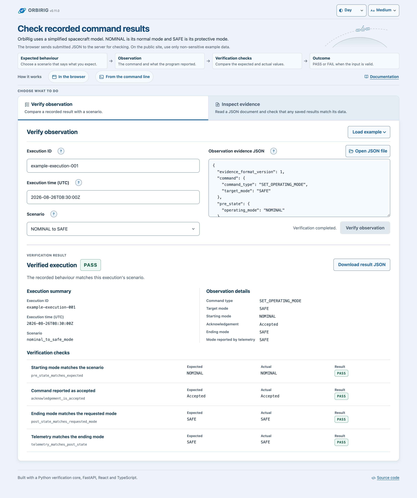

# Web interface

In the [OrbiRig web interface](https://orbirig-evidence-inspector.onrender.com/), use **Verify observation** to check a recorded command result against a **scenario**, the behaviour you expect. Use **Inspect evidence** to review an **evidence** document, which is JSON containing an observation or saved verification results. Both workflows use recorded data.

The browser sends submitted JSON to the server for checking. On the public site, use only non-sensitive example data.

In the header, **Color theme** defaults to **System**, which follows your device's light or dark setting. Choose **Day** or **Night** to keep a fixed palette. **Text size** offers **Small**, **Medium** and **Large**, with **Medium** selected by default.

Your browser remembers both choices when it allows local storage. When storage is unavailable, the choices apply for the current page. Changing either setting preserves your current inputs and results.

On narrow screens, **Open JSON file** appears as a folder icon beside the JSON field.

## Verify an observation

1. Switch to the **Verify observation** workflow.
2. Open **Load example** and choose **Standard example** to fill in a sample. To verify your own observation, select a **Scenario** and fill in **Execution ID** and **Execution time (UTC)**. The execution time is when the command ran, for example `2026-10-21T10:00:00Z`. Choose **Open JSON file** or paste the observation into **Observation evidence JSON**.
3. Choose **Verify observation** to see the expected and actual values for each check and the overall `PASS` or `FAIL`.

Choose a UTF-8 file of up to 4 MiB without a byte-order mark (BOM). Opening it fills only **Observation evidence JSON**. OrbiRig asks before replacing edited text. When you submit, the [request size limit](#request-size-limit) includes the execution metadata and the encoded observation.

**Standard example** uses the selected scenario or **NOMINAL to SAFE** when you have not selected one. The screenshot shows the completed default example in **Day** with **Medium** text.



**Failing example** fills in an observation whose telemetry (a separate report of the operating mode) disagrees with the recorded ending mode. Verifying it gives `FAIL`.

An [expected command rejection](verification.md#supported-scenarios) can pass. OrbiRig reports an input error before running the checks if the recorded command does not match the selected scenario. When entering your own record, follow the [rules for execution IDs and times](evidence-formats.md#execution-ids).

### Save and reopen a result

Choose **Download result JSON** next to a completed verification to save it as `orbirig-verified-execution.json`. You can save a `PASS` or a `FAIL`. For a `FAIL`, the saved checks show which expected and actual values differed.

The download reuses the result on screen. Changing an input clears the result and its download action.

To reopen the file, switch to **Inspect evidence**, select **Verified execution** and choose **Open JSON file**. Select the downloaded file, then choose **Inspect evidence**. OrbiRig recalculates the checks and shows the same scenario, check results and outcome.

You can also save a verified record [from the command line](cli.md#verify-the-bundled-example) or [with the Python API](python.md#reopen-saved-verified-evidence).

## Inspect evidence

1. Switch to the **Inspect evidence** workflow.
2. Select the **Evidence type**. Choose **Open JSON file**, paste the contents into **Evidence JSON** or choose a sample from **Load example**.
3. Choose **Inspect evidence** to check the document and view its contents.

Opening a file reads it in the browser and fills **Evidence JSON**. Use UTF-8 without a byte-order mark (BOM) and a file size of up to 4 MiB. OrbiRig asks before replacing edited text. Choose **Inspect evidence** when you are ready to send the document to the server for checking.

| Type | What inspection shows and checks |
| --- | --- |
| Observation | The reported command, modes, acknowledgement and telemetry. OrbiRig checks the format. Use **Verify observation** for a scenario check. |
| Verified execution | The time, ID, scenario, observation, checks and outcome for one command run. OrbiRig recalculates the results and checks that they match the saved values. |
| Verified execution sequence | The overall outcome, records in their saved order and continuity checks. OrbiRig recalculates each record's results and compares the ending mode of each record with the starting mode of the next. |

### Choose an inspection example

Open **Load example** to see the examples available for the selected evidence type. **Standard example** fills in valid JSON for that type.

- **Failing example** is available for **Verified execution** and **Verified execution sequence**. Both examples are valid saved evidence with a `FAIL` outcome. In the sequence example, each record passes and the continuity check fails.
- With **Verified execution sequence**, **Long sequence** gives you 100 records to browse and filter, including failed telemetry and continuity checks.
- **Altered example** gives invalid evidence. The observation repeats a field name. The verified examples contain saved results that disagree with the recorded values.

### Find failures in a sequence

The sequence outcome and counts of records and continuity checks marked `FAIL` cover the full document. OrbiRig shows up to 25 records per page. Each record keeps its original number and its continuity check with the next record, even across pages.

Use **Show failures and related records** to see failed records and both records in a failed continuity check. Use **Show details** on a record or continuity check to see its values. You can keep several details open to compare them.

Changing the page or filter closes the open details. Changing the filter also takes you to the first page. Starting another inspection clears the filter and returns to the first page.

## Inputs and results

- **Edit inputs.** Changing a value or the selected evidence type clears the current result and prompts a new check. Changing the evidence type keeps the JSON text. Switching workflows keeps each form's inputs, results and sequence view.
- **Replace inputs with an example.** OrbiRig asks before replacing edits. Choose **Cancel** to keep them. Loading the same values keeps a completed result.
- **Correct an error.** If a required field is blank, OrbiRig marks it before sending a request and moves keyboard focus to the first missing field. If the server rejects the data, use the error message to find the field or value to check.
- **Read a completed result.** OrbiRig leaves the result in place and makes the submit button unavailable until an input changes. Both `PASS` and `FAIL` complete a verification. Successful inspection of verified evidence includes its saved outcome.
- **Cancel a request.** Choose **Cancel request** while OrbiRig is checking. The browser stops waiting, keeps your inputs and returns focus to the submit button. A late response from that request cannot replace your inputs or results.

Results and request errors usually receive keyboard focus and are brought into view. If you have moved to another control, opened help or switched workflows since submitting, OrbiRig leaves focus where it is. Status messages announce completion.

## Help in the interface

Under **How it works**, choose **In the browser** or **From the command line**. The separate **Documentation** link opens the guide index in a new tab.

- **In the browser** gives steps for the selected workflow. Under **Verify observation**, **When a command returns no result (Python API example)** describes a [local Python run](stateful-target.md#simulate-a-response-failure-after-state-commit) where the program saves a change before a collection error.
- **From the command line** covers [CLI setup](cli.md), a command you can run and the expected output. **Understanding CLI results and exit codes** explains the return codes. **Verify a C#/.NET program (optional)** explains the outcomes of a [local .NET run](dotnet-stateful-target.md).

The guide keeps one section open at a time. Switching tabs or workflows, or reopening the guide, starts with the sections closed.

Opening a section scrolls only as far as needed. If the full section fits, the guide shows it, along with the next heading if that fits too. Where possible, it leaves some space below the section or the next heading. A longer section starts at its heading.

If the browser opens a section to reveal a search match, the guide keeps the match in view. Closing a section can shorten the scroll area. The browser may then move to the last available scroll position.

If resizing changes which area scrolls while a section is open, the guide brings the section heading into view. A control with visible keyboard focus in the scrolling area takes priority.

## Run locally

Install [Git](https://git-scm.com/downloads), [uv](https://docs.astral.sh/uv/getting-started/installation/) and Node.js 26 LTS. [`.node-version`](../.node-version) pins Node.js 26.13.0. See the [frontend environment](../CONTRIBUTING.md#frontend-environment) for selecting this version and platform requirements. Python 3.12–3.15 is supported; uv selects the local default from [`.python-version`](../.python-version).

From the repository root, check that the active Node.js version matches `.node-version`, then install the locked Python web and frontend dependencies:

```bash
node --version
uv sync --locked --extra web
cd frontend
npm ci
cd ..
```

From the repository root, start FastAPI in the first terminal.

```bash
# Terminal 1
uv run --no-sync python -m uvicorn orbirig.web:app --reload
```

In the second terminal, start Vite from the repository root using the Node.js version you selected for `npm ci`.

```bash
# Terminal 2
cd frontend
npm run dev
```

Open the URL printed by Vite, normally <http://localhost:5173>. Vite forwards `/api` requests to FastAPI at `127.0.0.1:8000`. To verify the example observation, open **Load example**, choose **Standard example**, then choose **Verify observation**.

For the full development environment, checks and browser-test setup, see [CONTRIBUTING.md](../CONTRIBUTING.md).

## Serve a production build locally

After installing dependencies, build the frontend before starting FastAPI:

```bash
cd frontend
npm run build
cd ..
# Start after the build so FastAPI registers the page and asset routes.
uv run --no-sync python -m uvicorn orbirig.web:app
```

Open <http://127.0.0.1:8000>. The build writes assets to the ignored `src/orbirig/static` directory. Python wheels and source distributions do not bundle those assets, so the complete interface requires this checkout-based build.

FastAPI checks for `index.html` and the `assets` directory at startup. If either is missing, the API remains available and frontend URLs return `404`. The header and browser tab use the same SVG mark. `/favicon.png` supplies a transparent fallback for browsers that lack SVG favicon support, such as Safari before version 26. After rebuilding the frontend, restart FastAPI to serve the new files.

The build uses [Vite 8's default browser targets](https://v8.vite.dev/guide/build#browser-compatibility): Chrome/Edge 111, Firefox 114 and Safari 16.4. These settings control generated code. Automated browser coverage and its limits are described in [Browser tests](../CONTRIBUTING.md#browser-tests).

## HTTP API

All 4 endpoints use `POST`:

| Endpoint | Request content type | Body |
| --- | --- | --- |
| `/api/verify/observation` | `application/json` | An object containing exactly the 4 string fields `execution_id`, `executed_at`, `scenario_id` and `observation_evidence` |
| `/api/inspect/observation` | `text/plain; charset=utf-8` | Raw observation-evidence JSON text |
| `/api/inspect/verified-execution` | `text/plain; charset=utf-8` | Raw verified-execution JSON text |
| `/api/inspect/verified-execution-sequence` | `text/plain; charset=utf-8` | Raw verified-sequence JSON text |

The server decodes both request types as UTF-8. Send JSON without a byte-order mark (BOM). If the server cannot decode the verification request as UTF-8 or parse its outer JSON object, it returns HTTP `422` with the `invalid_request` code.

For verification, `scenario_id` is one of the [scenario string values](verification.md#supported-scenarios). `observation_evidence` contains JSON as a string, not a nested object. FastAPI passes this string unchanged to `deserialize_execution_evidence(...)`, then delegates verification to `build_verified_execution_record(...)`.

For inspection, FastAPI decodes the submitted text and passes it to the matching evidence reader for validation. In both forms, the browser submits evidence as text, preserving repeated field names for Python to reject. If you open a file, the browser preserves its original line endings for submission until you edit the evidence text. The browser displays the results supplied by Python.

### Send an example request

With FastAPI running locally, send the bundled verification request from the repository root.

```bash
curl --header 'Content-Type: application/json' \
  --data-binary @docs/examples/verify-observation-request.json \
  http://127.0.0.1:8000/api/verify/observation
```

The [request file](examples/verify-observation-request.json) contains all 4 fields, with the observation encoded as a JSON string. The response is HTTP `200` with 4 passing checks, `"outcome": "PASS"` and the saved form of the record in `verified_execution_evidence`; see the [complete response](examples/verify-observation-response.json).

To inspect the bundled verified record, send its JSON directly as the request body.

```bash
# Send the file bytes unchanged, preserving whitespace and repeated JSON fields.
curl --header 'Content-Type: text/plain; charset=utf-8' \
  --data-binary @docs/examples/verified-execution.json \
  http://127.0.0.1:8000/api/inspect/verified-execution
```

### Responses

The HTTP status tells you whether the request succeeded. Read the response body for any `PASS` or `FAIL` outcome.

| HTTP status | Meaning |
| --- | --- |
| `200` | Completed verification or successful inspection. Both allow `FAIL` outcomes; observation inspection has no verification outcome. |
| `400` | An inspection body is not valid UTF-8. |
| `413` | The request body exceeds the size limit below. |
| `415` | The request content type is unsupported. |
| `422` | A verification request or submitted evidence is invalid. |
| `500` | An unexpected server error, separate from verification `FAIL`. |

Successful responses contain display data. A completed verification also returns `verified_execution_evidence`: the [verified execution evidence](evidence-formats.md#verified-execution-evidence) for the same record, as one JSON string. Python creates it with `serialize_verified_execution_evidence(...)`, so it uses schema version 1, the canonical field order and a final newline. For the bundled request, it matches [verified-execution.json](examples/verified-execution.json).

Save that string unchanged as a UTF-8 file to reopen it later with `/api/inspect/verified-execution`. Only completed verification responses contain the field. Inspection and error responses do not.

For HTTP `422` verification errors, `detail` contains a `code` and `message`. For example, selecting `safe_to_nominal_mode` for the example command, which requests `SAFE`, returns:

```json
{
  "detail": {
    "code": "scenario_command_mismatch",
    "message": "observation command does not match the selected scenario"
  }
}
```

Invalid inspection evidence returns a string in `detail`. Where available, it identifies a field and the kind of problem, for example `"verified execution sequence evidence is invalid. records[57].observation.telemetry.operating_mode: must be a string"`. Array indices start at 0. Diagnostics cover invalid structure, types, values and stored results that disagree with recomputed checks. They do not echo submitted values or unknown field names.

Missing-field diagnostics name only fields required by the selected schema. A document submitted under a different evidence type is rejected against that selected schema; the server does not detect or switch its type automatically. JSON parsing errors, such as repeated field names, may identify the problem without a field path.

Invalid observation messages use the same field-level diagnostics. Metadata errors also include `field: "execution_id"` or `field: "executed_at"`, which the browser uses to mark the field and show its error.

### Request size limit

Each endpoint limits the complete body to **4 MiB (4,194,304 bytes), inclusive**. Verification counts the encoded JSON wrapper and embedded evidence string. Inspection counts the submitted UTF-8 bytes. This HTTP limit does not apply to the Python evidence APIs.

Saved evidence can be larger than the verification request. The API checks that the saved UTF-8 JSON also fits within 4 MiB, so **Inspect evidence** can reopen it. If a long **Execution ID** makes the saved document exceed the limit, verification returns HTTP `422` with `invalid_execution_metadata` and asks you to shorten the ID.

Content-type checks run before body-size checks. The server enforces the size limit while reading, regardless of `Content-Length`. After an oversized request, the interface keeps entered values and selections and explains how to reduce the data before resubmitting.

## Render deployment configuration

[`render.yaml`](../render.yaml) declares a Python web service built from `main`, using uv `0.13.4`, `npm ci` and a frontend build. It sets `PYTHON_VERSION=3.12.16`, uses `/` for its health check and declares `autoDeployTrigger: checksPass`.

Render's [native Python runtime also provides Node.js and npm](https://render.com/docs/native-runtimes#tools-and-utilities) for building the frontend. The Blueprint sets `NODE_VERSION=26.13.0` for these build tools. This [setting takes precedence](https://render.com/docs/node-version) over the root `.node-version`; keep the two values aligned. Confirm the applied setting and selected Node.js version in the service's build logs after a Blueprint sync.

The Python installation uses `uv sync --locked` with only the `web` extra and no default dependency groups. A missing or out-of-date `uv.lock` fails the build rather than being updated. OrbiRig is installed in editable mode in `.venv`, so it can serve the assets subsequently built into `src/orbirig/static`. The start command runs `.venv/bin/python` directly, using the installed environment without resolving dependencies again.

When applied, Render's [`PYTHON_VERSION` setting takes precedence](https://render.com/docs/python-version) over `.python-version`. The sync command explicitly selects that version and disables Python downloads by uv: Render must provide the declared interpreter. Changing the local development default does not change this runtime selection. Render provides uv when a root-level `uv.lock` is present; [`UV_VERSION`](https://render.com/docs/uv-version) pins its version.

Check the service's applied settings and deployed commit separately from this declaration. The lock pins the selected Python application dependencies, with the [build-dependency and platform limitations](../CONTRIBUTING.md#python-environment) described in the development guide.
